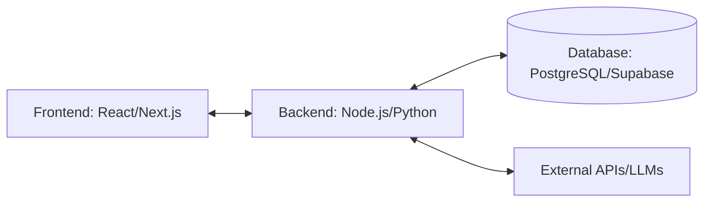

# Technical Specs and Strategic Planning: Grand Prix SENAI 2026

## 1. Executive Summary
This document outlines the strategic approach, technical specifications, and resource planning for competing in the Grand Prix SENAI 2026. The goal is to maximize the team's chances of winning by executing a focused, well-resourced, and technically sound project within the 5-day hackathon window.

## 2. Strategic Planning (Resource, Time, Budget, BI)

### 2.1 Time Management (The 5-Day Sprint)
The competition runs from April 13 to April 17. Time is our most critical resource.

*   **Prep Week (April 6-10):** Attend all capacitation lives. Finalize team roles and preliminary tech stack. Start brainstorming around the core themes (accessibility, cybersecurity, automation, sustainability).
*   **Day 1 (Apr 13) - Problem & Architecture:** Lock in the specific challenge statement. Define the MVP scope. Set up repositories, CI/CD pipelines, and cloud environments.
*   **Day 2 (Apr 14) - Core Backend & Data:** Database schema creation, core API development, and data scraping/engineering (if BI logic is required for the solution).
*   **Day 3 (Apr 15) - Frontend & Integration:** Develop the user interface according to predefined design tokens. Connect frontend to backend APIs.
*   **Day 4 (Apr 16) - Refinement & Pitch Prep:** Feature freeze by midday. Focus on bug fixing, UX polishing, and drafting the pitch script/presentation.
*   **Day 5 (Apr 17) - Quality Assurance & Submission:** Record the pitch video (max 3 minutes usually). Final QA of the prototype. Submit all deliverables before the 23:59 deadline.

### 2.2 Budget & Infrastructure
Since this is a fast-paced hackathon, we must rely on free tiers and rapid deployment tools.

*   **Hosting & Deployment:**
    *   Frontend: Vercel or Netlify (Free Tier).
    *   Backend/API: Render, Railway, or Heroku (Free Tier).
    *   Database: Supabase (PostgreSQL), Firebase, or MongoDB Atlas (Free Tier).
*   **Domain & SSL:** Use default subdomains provided by the hosting platforms to save time and budget.
*   **Collaboration Tools:**
    *   Code: GitHub (with GitHub Actions for CI/CD).
    *   Communication: Discord or Slack.
    *   Design/Prototyping: Figma.
    *   Project Management: Notion or Trello.

### 2.3 Business Intelligence (BI) & Market Validation
To win, the solution must not only work technically but also make business sense.

*   **Market Data:** Quickly gather open data (e.g., IBGE, raw CSV datasets related to the chosen theme) to validate the problem size.
*   **Competitor Analysis:** Create a simple matrix comparing our proposed solution against existing market alternatives to highlight our Unique Value Proposition (UVP).
*   **Impact Metrics:** Define clear KPIs for the prototype (cost savings, time efficiency, environmental impact reduction) to present to the judges.

## 3. Technical Specifications (MVP Level)

### 3.1 Architecture Overview
A decoupled architecture is recommended for speed and parallel development.

### 3.2 Frontend Requirements
*   **Framework:** React or Next.js (for fast rendering and easy deployment).
*   **Styling:** Tailwind CSS or a robust component library (e.g., shadcn/ui, Material-UI) for rapid, consistent styling.
*   **Responsiveness:** Must be mobile-first. Judges often test prototypes on their phones.
*   **State Management:** React Context or Zustand (keep it simple, avoid Redux overhead unless necessary).

### 3.3 Backend Requirements
*   **Framework:** Node.js (Express/NestJS) or Python (FastAPI). Python is preferred if heavy data processing or AI integration is needed.
*   **API Design:** RESTful structure. Keep endpoints minimal.
*   **Authentication:** JWT or OAuth (use Supabase/Firebase Auth to save time).
*   **Error Handling:** Robust error logging to avoid breaking the demo during the judges' review.

### 3.4 Data & AI (Differentiator)
*   If the theme allows, integrate a basic LLM capability (e.g., OpenAI API) to add a "wow" factor (e.g., automated report generation, smart search, natural language interface).
*   Ensure data models are simple and flexible (JSONB columns in Postgres can help adapt to changing requirements mid-hackathon).

## 4. Submission Checklist (The "Winning" Package)
1.  **Functional Prototype:** A live URL demonstrating the core value proposition. Must clearly address the challenge theme.
2.  **Source Code:** A clean, documented GitHub repository. Include a comprehensive README.md with setup instructions and an architecture diagram.
3.  **Pitch Deck:** A 5-10 slide presentation (Problem, Solution, Market, Business Model, Team).
4.  **Pitch Video:** A concise, high-energy video summarizing the project. Show, don't just tell (include a demo of the prototype).
