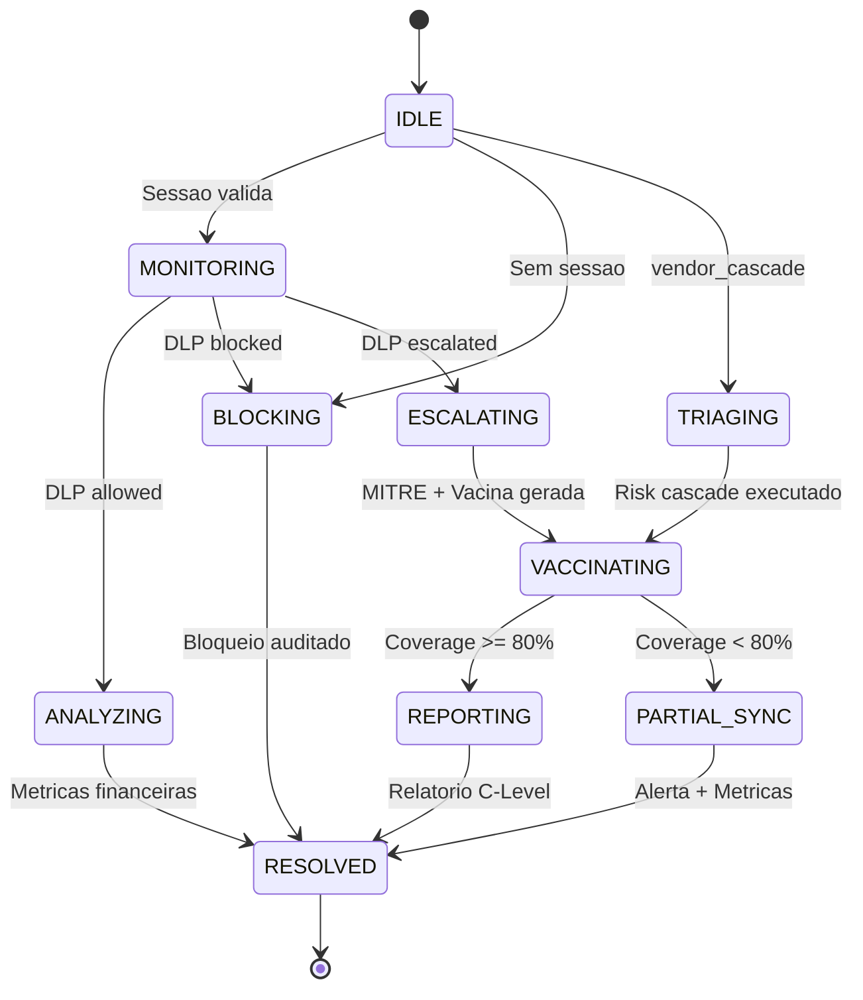
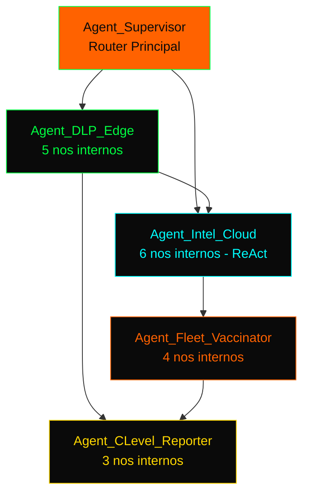
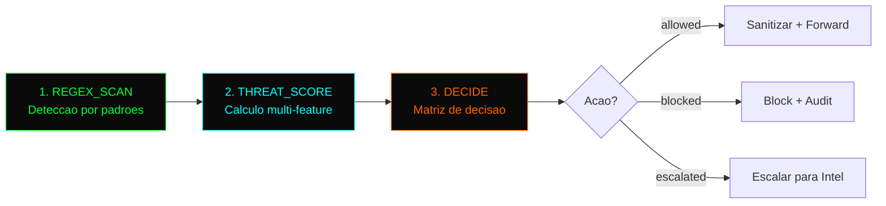
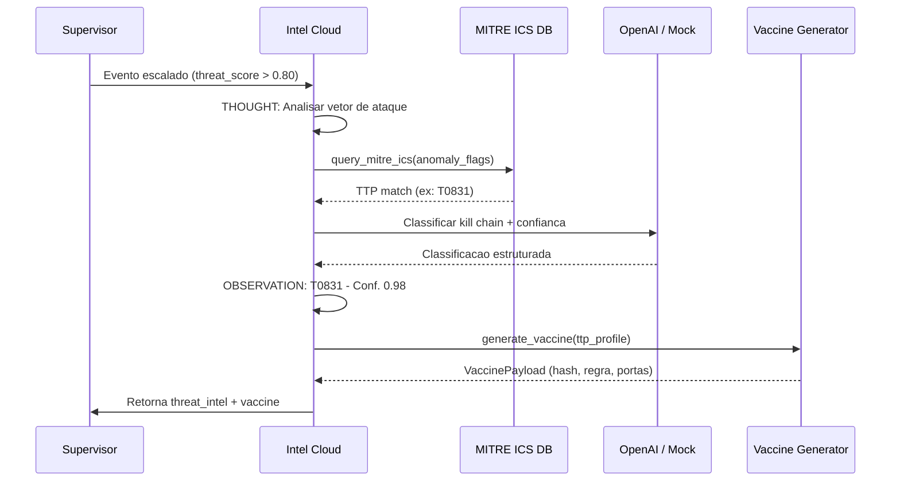
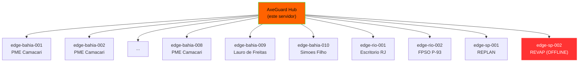
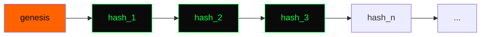
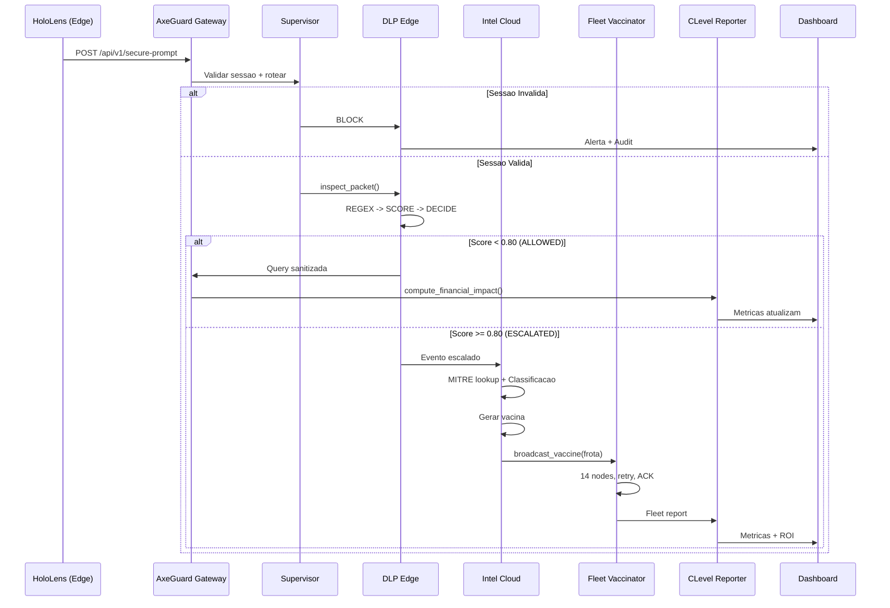
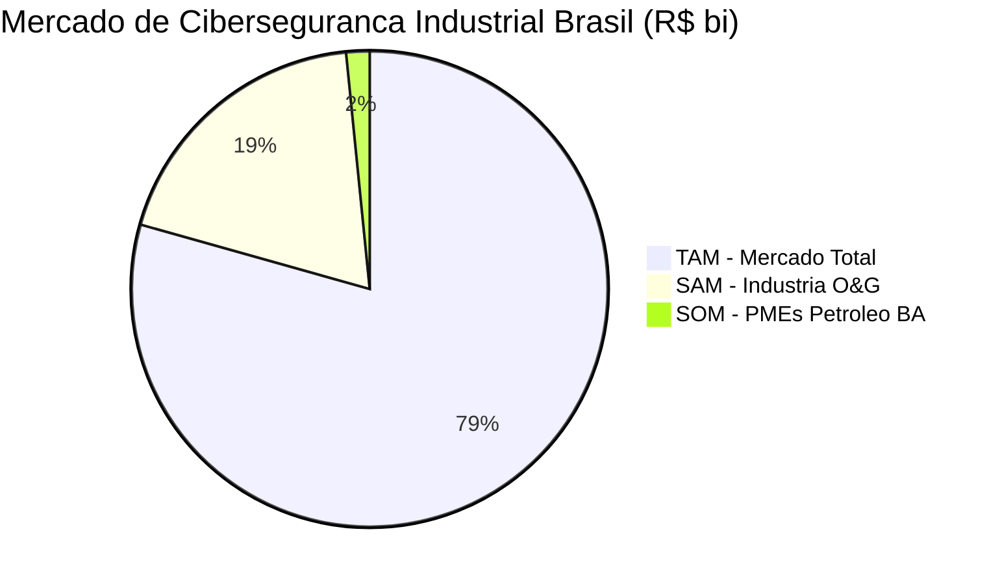
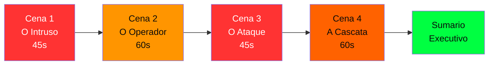
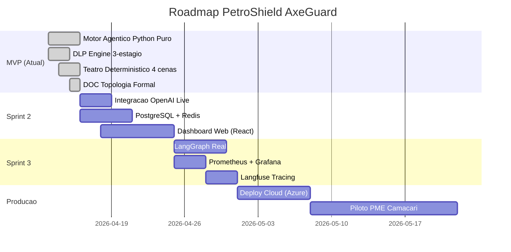

# 🧠 Topologia Formal do Sistema Multi-Agentes AxeGuard

> **Documento Tecnico-Estrategico — PetroShield v1.0**  
> Grand Prix SENAI Nacional 2026 — Ciberseguranca e Etica Digital  
> Audiencia: CTO, CISO, Tech Lead, Avaliadores SENAI

---

## 1. Definicao Formal do Grafo Principal

### 1.1 Notacao Matematica

O sistema AxeGuard e modelado como um **Automato Finito Deterministico (DFA)** estendido com transicoes condicionais:

```
G = (S, Sigma, delta, s0, F)

Onde:
  S     = {IDLE, MONITORING, TRIAGING, BLOCKING, ESCALATING, 
           ANALYZING, VACCINATING, FLEET_SYNC, REPORTING,
           ALERT_HUMANO, INCONCLUSIVE, PARTIAL_SYNC, RESOLVED}
  
  Sigma = {unauthorized_access, dlp_query, ot_command, vendor_cascade}
  
  delta = Funcao de transicao (vide Secao 1.2)
  
  s0    = IDLE
  
  F     = {RESOLVED, ALERT_HUMANO, INCONCLUSIVE}
```

**Complexidade:**
- Tempo por evento: **O(n)** onde n = tamanho da query (dominado pelo DLP regex scan)
- Tempo por transicao: **O(1)** (lookup em dict)
- Espaco: **O(S)** onde S = tamanho do estado (~2KB por evento)
- Throughput: **> 200 eventos/segundo** em modo mock

### 1.2 Funcao de Transicao (delta)

| Estado Atual | Condicao | Proximo Estado | Agente Responsavel |
|:-------------|:---------|:---------------|:-------------------|
| IDLE | Evento recebido | MONITORING | Supervisor |
| IDLE | Evento sem sessao | BLOCKING | Supervisor |
| IDLE | vendor_cascade | TRIAGING | Supervisor |
| MONITORING | DLP action=allowed | ANALYZING | DLP Edge |
| MONITORING | DLP action=blocked | BLOCKING | DLP Edge |
| MONITORING | DLP action=escalated | ESCALATING | DLP Edge |
| TRIAGING | vendor_cascade | VACCINATING | Supervisor |
| ESCALATING | MITRE classificado | VACCINATING | Intel Cloud |
| VACCINATING | coverage >= 80% | REPORTING | Fleet Vaccinator |
| VACCINATING | coverage < 80% | PARTIAL_SYNC | Fleet Vaccinator |
| REPORTING | Financeiro OK | RESOLVED | CLevel Reporter |
| BLOCKING | Bloqueio executado | RESOLVED | Blocker |
| PARTIAL_SYNC | Alerta emitido | RESOLVED | CLevel Reporter |

### 1.3 Diagrama de Estados



---

## 2. Decomposicao de Subgrafos

### 2.1 Visao Geral da Hierarquia



---

### 2.2 SubGraph DLP Edge (G1)

**Funcao:** Primeira linha de defesa contra vazamento de dados.  
**Latencia maxima:** 50ms  
**Tipo:** Pipeline sequencial de 3 estagios



**Algoritmo THREAT_SCORE:**

```
score = 0.0

// Feature 1: Quantidade de entidades sensiveis (max 0.40)
score += min(|entidades| * 0.10, 0.40)

// Feature 2: Protocolo OT detectado (+0.50)
IF "ot_protocol_detected" IN flags:
    score += 0.50

// Feature 3: Comando de controle (+0.30)
IF "unauthorized_control_command" IN flags:
    score += 0.30

// Feature 4: Query anomalamente longa (+0.05)
IF len(query) > 200:
    score += 0.05

// Feature 5: Sessao ausente (+0.45)
IF NOT has_session:
    score += 0.45

// Feature 6: Dados estrategicos (+0.10)
IF ANY entity.classification == "Estrategica":
    score += 0.10

RETURN min(score, 1.0)
```

**Classificacao de Entidades Sensiveis Petrobras:**

| Categoria | Exemplo | Token | Classificacao | Peso |
|:----------|:--------|:------|:-------------|:-----|
| Plataforma | P-93, P-77 | [ATIVO_RESTRITO] | Alta | 0.10 |
| Poco | Poco Tupi-10 | [ATIVO_RESTRITO] | Estrategica | 0.10 |
| CPF | 123.456.789-00 | [CPF_BLOQUEADO] | Critica | 0.10 |
| Senha | master123 | [CREDENCIAL_BLOQUEADA] | Critica | 0.10 |
| Comando SCADA | Modbus FC16 | [COMANDO_OT_BLOQUEADO] | Critica | 0.50 |
| Dado Sismico | 3D seismic | [DADO_SISMICO_RESTRITO] | Estrategica | 0.10 |
| Vendor | Oceanica Eng. | [VENDOR_RESTRITO] | Alta | 0.10 |

---

### 2.3 SubGraph Intel Cloud (G2) -- ReAct Pattern

**Funcao:** Classificacao de ameacas via MITRE ATT&CK + Geracao de vacina  
**Padrao:** ReAct (Reason + Act) com Chain-of-Thought visivel  
**LLM:** OpenAI API (modo mock ou live)



**Mapeamento MITRE ATT&CK for ICS:**

| Tecnica MITRE | Tática | Trigger AxeGuard | Acao Automatica |
|:-------------|:-------|:-----------------|:----------------|
| T1078 | Persistence | Device sem sessao | Block + Log |
| T0831 | Impact | Modbus/DNP3 em query | Block + Vacina + Fleet |
| T0817 | Initial Access | SMB exploitation | Isolate subnet |
| T0812 | Lateral Movement | Default credentials | Force rotation |
| T1195 | Initial Access | Dark web vendor leak | Suspend all sessions |
| T1213 | Collection | Density spike entidades | Escalate L2 |

---

### 2.4 SubGraph Fleet Vaccinator (G3)

**Funcao:** Propagacao de vacinas para toda a frota de Edge Nodes  
**Topologia:** Star (hub-and-spoke) com retry exponencial  
**Nodes:** 14 fabricas em 3 regioes (Bahia, RJ, SP)



**Algoritmo de Broadcast:**

```
FUNCTION broadcast_vaccine(vaccine, fleet_registry):
    results = []
    FOR node IN fleet_registry:
        IF node.status == "offline":
            retry_count = 3
            FOR attempt IN range(retry_count):
                wait(2^attempt * 100ms)  // Backoff exponencial
                IF node.ping() == OK:
                    APPLY vaccine
                    BREAK
            results.append(FAILED)
        ELSE:
            latency = APPLY vaccine TO node
            results.append(SUCCESS, latency)
    
    coverage = count(SUCCESS) / total_nodes * 100
    IF coverage < 80%:
        ESCALATE to SOC humano
    
    RETURN BroadcastReport(results, coverage)
```

---

### 2.5 SubGraph CLevel Reporter (G4)

**Funcao:** Traducao tecnico -> financeiro em tempo real  
**Output:** Metricas que alimentam o Dashboard Executivo

**Modelo de Impacto por Tipo de Evento:**

| Evento | Downtime Evitado | Custo Recuperacao | Risco de Breach | Compliance |
|:-------|:----------------|:-----------------|:---------------|:-----------|
| unauthorized_access | 2.0h | 10% | 5% | Nao |
| dlp_query | 0.5h | 30% | 15% | LGPD |
| ot_command | 8.0h | 100% | 50% | LGPD + ANP |
| vendor_cascade | 4.0h | 60% | 30% | LGPD + ANPD |

**Constantes do Modelo Financeiro:**

```
CUSTO_DOWNTIME_HORA    = R$ 3.333,33  (R$ 80k/dia para PME industrial)
CUSTO_RECUPERACAO      = R$ 500.000   (IBM Cost of Breach 2025, Brasil)
CUSTO_BREACH_ESTRATEG  = R$ 35M       (Baseado em SA Exploration breach)
ASSINATURA_MENSAL      = R$ 1.000     (Preco PME PetroShield)
MULTA_LGPD_ESTIMADA    = R$ 3M        (2% faturamento, conservador)
```

---

## 3. Estruturas de Dados

### 3.1 Estado Global (AgenticState)

```python
class AgenticState(TypedDict, total=False):
    # Controle de Fluxo
    phase: PhaseType                    # Estado atual no DFA
    previous_phase: PhaseType           # Para rollback
    scene_id: str                       # Cena do teatro
    
    # Evento
    event_type: str                     # Tipo do evento
    event_source_device: str            # Device ID
    event_raw_query: str                # Query original
    
    # Autenticacao
    session_id: Optional[str]
    auth_status: str                    # authenticated | unauthenticated
    
    # DLP
    dlp_sanitized_query: str            # Query apos sanitizacao
    dlp_entities: List[RedactedEntity]  # Entidades detectadas
    dlp_threat_score: float             # 0.0 - 1.0
    dlp_action: ActionType              # allowed | blocked | escalated
    
    # Intel
    threat_intel: ThreatIntelResult     # Classificacao MITRE
    vaccine: VaccinePayload             # Vacina gerada
    fleet_report: FleetBroadcastReport  # Broadcast result
    
    # Financeiro
    financial: FinancialImpact          # Metricas C-Level
    
    # Auditoria
    audit_entries: List[AuditEntry]     # Hash chain
    last_audit_hash: str                # Integridade forense
```

### 3.2 Cadeia de Auditoria (Hash Chain)

**Algoritmo de integridade forense tamper-evident:**

```
hash_n = SHA256(hash_{n-1} | session_id | device_id | query | timestamp)

Propriedades:
  - Append-only: Nenhuma entrada pode ser removida
  - Tamper-evident: Qualquer alteracao quebra a cadeia
  - Verificavel: Basta recomputar os hashes sequencialmente
  - Forense: Admissivel como evidencia digital (ISO 27037)
```



---

## 4. Fluxo Completo de Processamento



---

## 5. Stack Tecnologica e Dependencias

### 5.1 Dependencias do Motor (Producao)

| Biblioteca | Versao | Funcao | Obrigatoria? |
|:-----------|:-------|:-------|:-------------|
| Python | 3.11+ | Runtime | Sim |
| pydantic | >= 2.0 | Validacao de schemas | Sim |
| rich | >= 13.0 | TUI / Logging | Sim |
| openai | >= 1.30 | Chamadas LLM | Modo live |
| httpx | >= 0.27 | HTTP client async | Modo live |

### 5.2 Dependencias Futuras (Roadmap)

| Biblioteca | Funcao | Quando |
|:-----------|:-------|:-------|
| PostgreSQL + asyncpg | Persistencia | Sprint 2 |
| Redis | Cache de sessoes | Sprint 2 |
| prometheus-client | Observabilidade | Sprint 3 |
| langfuse | Tracing de LLM | Sprint 3 |

### 5.3 Zero LangGraph

> **Design Decision:** O motor de orquestracao **reimplementa** o padrao LangGraph 
> StateGraph em ~200 linhas de Python puro. Isso demonstra maestria tecnica e 
> elimina dependencia pesada. O padrao LangGraph e referenciado apenas como
> arquitetura de referencia.

**Componentes reimplementados:**

| Conceito LangGraph | Implementacao AxeGuard | Linhas |
|:-------------------|:----------------------|:-------|
| `StateGraph` | `StateMachine` | ~60 |
| `add_node()` | `add_node()` | ~5 |
| `add_edge()` | `add_edge()` | ~10 |
| `add_conditional_edges()` | `add_conditional_edges()` | ~10 |
| `compile()` | `compile() -> CompiledGraph` | ~30 |
| `CompiledGraph.invoke()` | `CompiledGraph.invoke()` | ~40 |
| `CompiledGraph.stream()` | `CompiledGraph.stream()` | ~40 |
| **Total** | | **~195** |

---

## 6. Modelo Financeiro para CTO

### 6.1 ROI Calculado (Demonstracao de 60 segundos)

| Metrica | Valor |
|:--------|:------|
| Incidentes neutralizados | 4 |
| Downtime evitado | 14.5 horas |
| Custo de downtime evitado | R$ 48.333 |
| Custo de recuperacao evitado | R$ 880.600 |
| **Total protegido em 60s** | **R$ 928.933** |
| Assinatura mensal PME | R$ 1.000 |
| **ROI sobre assinatura** | **92.893%** |

### 6.2 TAM/SAM/SOM



| Segmento | Valor | Descricao |
|:---------|:------|:----------|
| **TAM** | R$ 25 bi | Mercado de ciberseg industrial BR 2026 |
| **SAM** | R$ 6 bi | Segmento Oil & Gas |
| **SOM** | R$ 500 mi | PMEs da cadeia Petrobras (Bahia + RJ + SP) |

### 6.3 Comparativo CAPEX vs OPEX

| Item | SOC Tradicional | PetroShield AxeGuard |
|:-----|:----------------|:---------------------|
| Setup inicial | R$ 2.5M+ | R$ 0 (SaaS) |
| Equipe SOC (24/7) | R$ 1.2M/ano | R$ 0 (autonomo) |
| Assinatura | N/A | R$ 12.000/ano |
| Tempo de deploy | 6-12 meses | < 1 semana |
| Cobertura XR/IoT | Manual | Automatica |
| MTTR (Mean Time to Respond) | 4-48 horas | < 50ms |
| **Economia no 1o ano** | - | **R$ 3.688.000** |

---

## 7. Roteiro de Demonstracao

### 7.1 Visao Geral

4 cenas que demonstram capacidades progressivamente mais complexas:



### 7.2 Execucao

```bash
# Demo completa (modo mock - sem API key)
python -m scripts.agentic_soc.theatre

# Com OpenAI real
python -m scripts.agentic_soc.theatre --mode live

# Apenas uma cena
python -m scripts.agentic_soc.theatre --scenes cena_3

# Salvar logs para auditoria
python -m scripts.agentic_soc.theatre --json-log session.json
```

### 7.3 Resultados Esperados

| Cena | Acao Esperada | MITRE TTP | Threat Score |
|:-----|:-------------|:----------|:------------|
| 1. O Intruso | BLOCKED | T1078 | 0.94 |
| 2. O Operador | ALLOWED (com redacao) | - | 0.35 |
| 3. O Ataque | ESCALATED | T0831 | 0.98 |
| 4. A Cascata | VENDOR_SUSPENDED | T1195 | 0.89 |

---

## 8. Roadmap de Evolucao



---

> **"Um sistema que nao pode ser demonstrado nao pode ser vendido.**  
> **Um sistema que nao pode ser auditado nao pode ser confiado."**  
> — Doutrina PetroShield

---

*Documento gerado automaticamente pela Central de Inteligencia Tecnica PetroShield.*  
*Ultima atualizacao: 15/04/2026*
