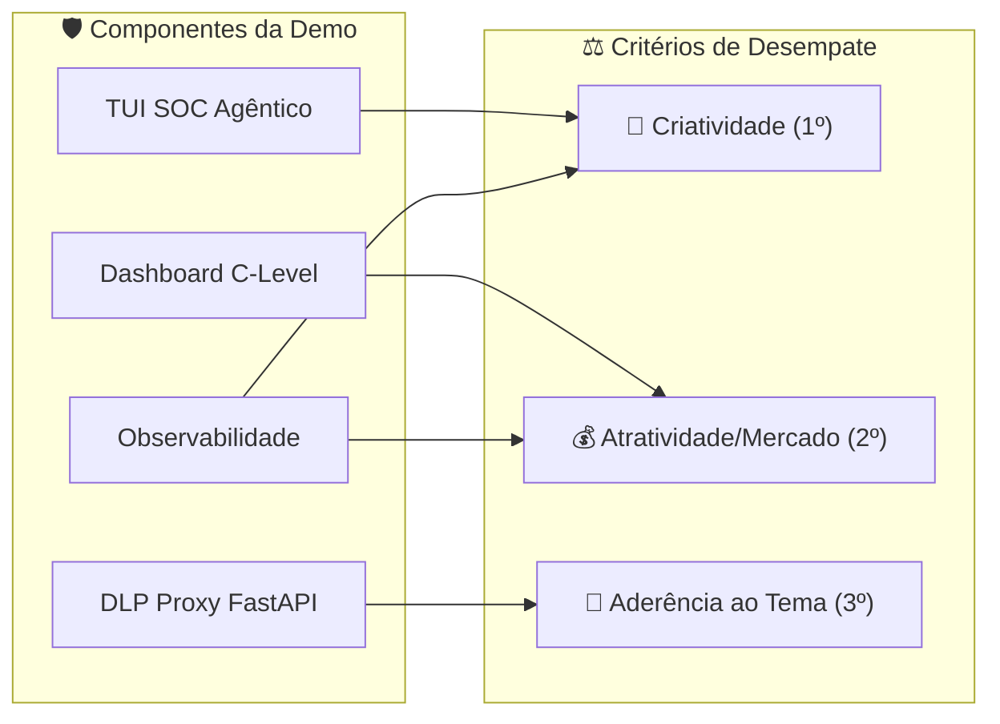
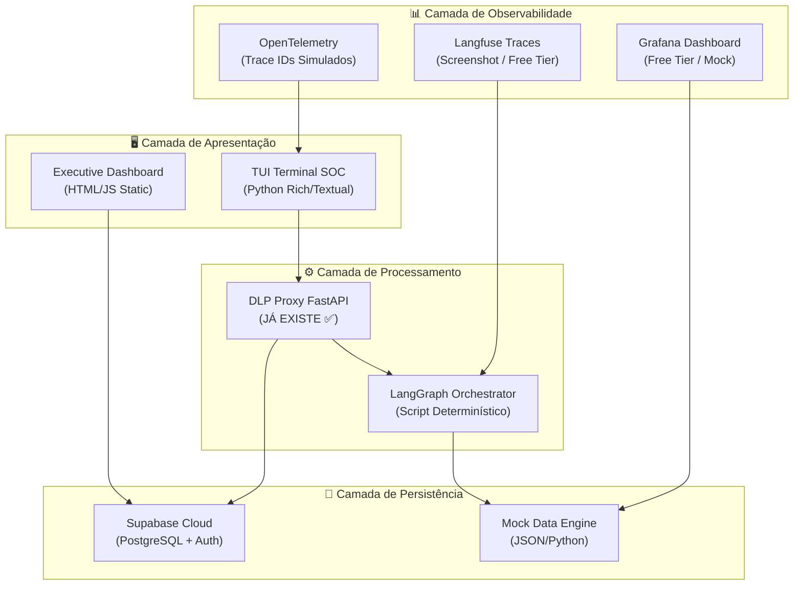
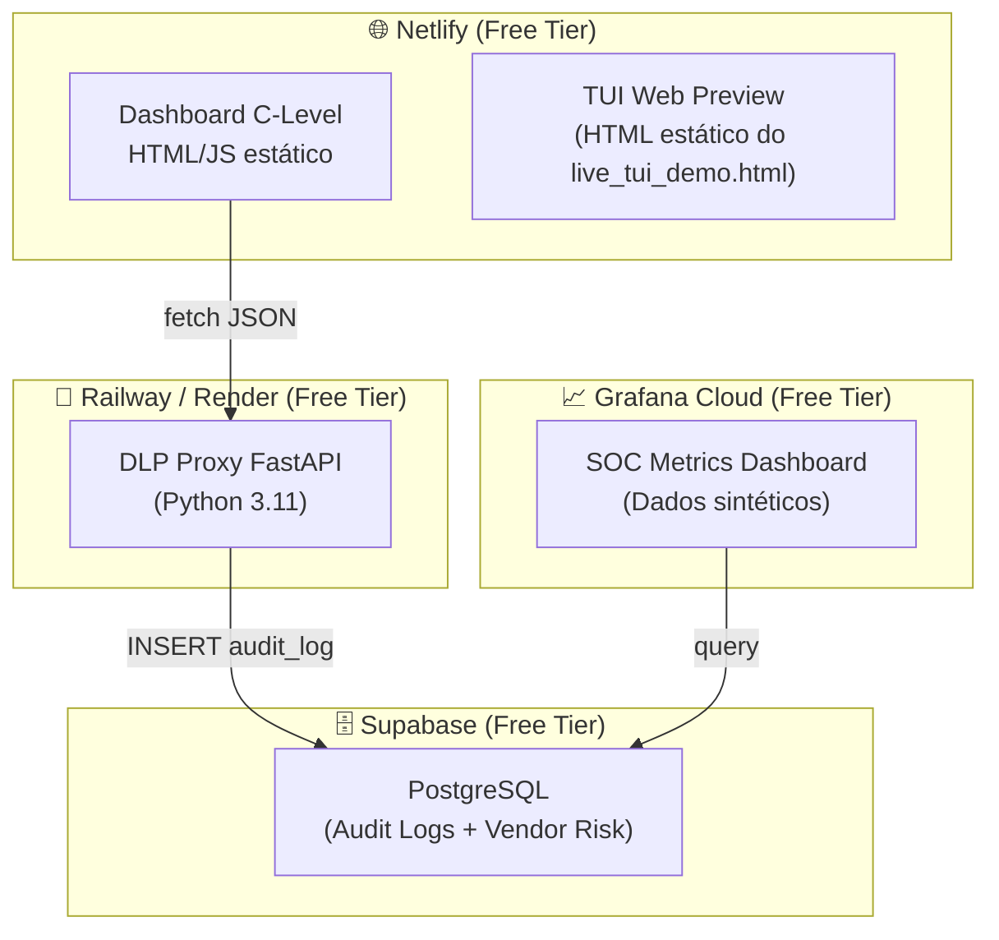
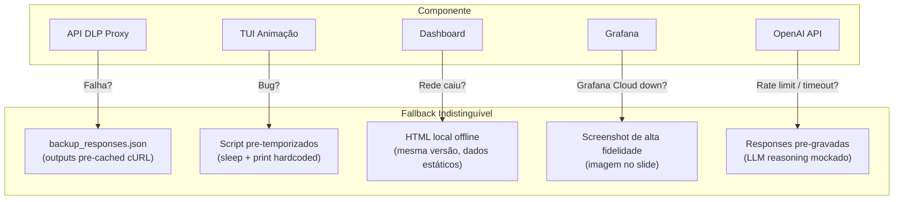
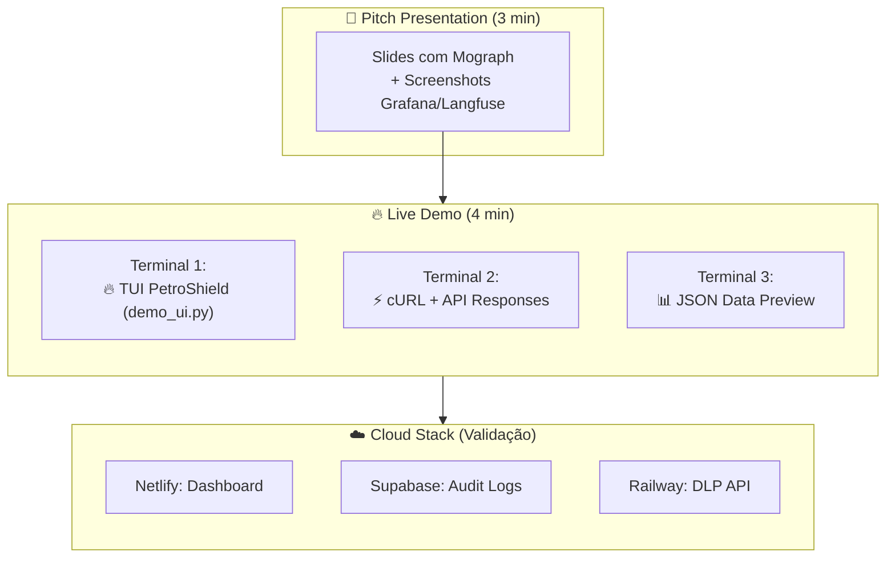

# 🎯 Viabilidade Técnica: AxeGuard Interactive Tech Demo
## Decomposição de Sistemas, Componentes e Estratégia de Entrega

**Classificação:** Documento Interno de Planejamento — SENAI Grand Prix 2026  
**Versão:** 1.0 — Fase E2/E3 (Prototipagem + Pitch Final)  
**Data:** 15/04/2026  
**Premissa Central:** Entregar "para ontem" com a régua o mais alto possível.

---

## 1. Meta-Objetivo: Gabaritar os Critérios de Desempate

O protótipo não é um MVP comercial — é uma **arma de pitch** calibrada para maximizar pontuação em 3 eixos simultâneos, perante dois públicos distintos:

| Público | O Que Querem Ver | Como Entregamos |
| :--- | :--- | :--- |
| **Líder Técnico Petrobras** | Prova de conceito com fidedignidade ao ambiente industrial (OT/ICS, DLP, Zero-Trust) | DLP Proxy ao vivo + TUI com reasoning chain visível |
| **Avaliadores Não-Técnicos da Banca** | Impacto de mercado, ROI em R$, UX/UI premium | Dashboard C-Level com métricas financeiras animadas |
| **IA de Análise Semântica do SENAI** | Palavras-chave do edital: autenticação, retenção, vazamento, LGPD | Aderência textual nos slides e narração |



---

## 2. Decomposição de Componentes (System Breakdown)

### 2.1 Mapa de Componentes e Dependências



### 2.2 Descrição Funcional por Componente

#### 🔴 TUI SOC Agêntico (Terminal User Interface)

**Propósito:** Demonstrar o raciocínio interno do SOC AxeGuard — glass-box intelligence. É o **"WOW Factor" para o líder técnico da Petrobras.**

**Estratégia de Implementação:**

| Aspecto | Decisão |
| :--- | :--- |
| Framework | Python Rich ou Textual (já temos `demo_ui.py` rodando) |
| LangGraph | **Script determinístico** com chamadas reais à OpenAI API para reasoning visível |
| Fluxo | Pré-programado com 4 cenas (Auth Block → DLP Magic → OT Block → Vendor Cascade) |
| Dados | Mock data hardcoded com variações aleatórias para parecer orgânico |
| Animações | ASCII torch (já existe), progress bars, typewriter effect nos `THOUGHT:` |

**Leverage para Criatividade (1º desempate):** O avaliador vê o agente *pensando em tempo real*. Nenhuma outra equipe terá um SOC autônomo com Chain of Thought visível em terminal cyberpunk.

#### 📊 Executive Dashboard (WebApp Estático)

**Propósito:** Traduzir a operação técnica em linguagem C-Level — ROI em R$, status LGPD, frota protegida.

**Estratégia de Implementação:**

| Aspecto | Decisão |
| :--- | :--- |
| Stack | HTML + Vanilla JS + CSS (zero framework, zero build) |
| Deploy | Netlify static (drag & drop, online em 30s) |
| Dados | JSON estático simulando WebSocket push (setInterval atualiza counters) |
| Design | Paleta PetroShield (verde neon #00FF41 + laranja #FF6200 + preto void #0A0A0A) |
| Cards | Ameaças Ativas, Downtime Evitado (h), ROI Salvaguardado (R$), LGPD Status, Frota Vacinada |

**Leverage para Atratividade/Mercado (2º desempate):** O avaliador não-técnico vê números reais de impacto financeiro. O contador animado de R$ é irresistível em pitch.

> [!TIP]
> O dashboard já existe em `06_Entregas/E2_Prototipagem/axeguard_dashboard.html`. Precisa apenas de refinamento visual e conexão com dados mock realistas.

#### 🔒 DLP Proxy FastAPI (Middleware Core)

**Status: JÁ EXISTE E ESTÁ RODANDO ✅**

**Localização:** `scripts/dlp_proxy/main.py` (uvicorn ativo na porta 8000)

**Expansões Necessárias para Demo Completa:**

| Endpoint | Status | Esforço |
| :--- | :--- | :--- |
| `POST /api/v1/secure-prompt` | ✅ Funcionando | 0h |
| `POST /api/v1/vendor-risk-cascade` | ✅ Funcionando | 0h |
| `GET /api/v1/metrics` (JSON mock) | ❌ Criar | 1h |
| `GET /api/v1/audit-log` (retorno JSON) | ❌ Criar | 1h |

**Leverage para Aderência ao Tema (3º desempate):** É a resposta direta ao `problem.txt` da Petrobras — autenticação, retenção e prevenção de vazamento demonstrados ao vivo.

#### ☁️ Supabase Cloud Backend

**Propósito:** Persistência de audit logs + demonstração de stack enterprise real (PostgreSQL hosted).

| Aspecto | Decisão |
| :--- | :--- |
| Tier | Free (500MB, 50k monthly active users) |
| Uso Real | Gravar `prompt_audit_log` e `threat_patterns` |
| Auth | Não usar Supabase Auth (já temos JWT mockado) |
| Deploy | Zero-ops, criar projeto via dashboard web |

**Tabelas necessárias:**

```sql
-- Audit log de prompts DLP
CREATE TABLE prompt_audit_log (
    id UUID DEFAULT gen_random_uuid() PRIMARY KEY,
    created_at TIMESTAMPTZ DEFAULT now(),
    device_id TEXT NOT NULL,
    original_query_length INT,
    sanitized_query TEXT,
    data_leak_prevented BOOLEAN DEFAULT false,
    redaction_count INT DEFAULT 0,
    threat_score FLOAT DEFAULT 0.0,
    operator_action TEXT, -- 'allowed', 'blocked', 'escalated'
    mitre_technique TEXT
);

-- Vendor risk graph
CREATE TABLE vendor_risk_graph (
    id UUID DEFAULT gen_random_uuid() PRIMARY KEY,
    vendor_id TEXT NOT NULL,
    vendor_name TEXT,
    risk_score INT DEFAULT 0,
    risk_level TEXT, -- 'LOW', 'MEDIUM', 'HIGH', 'CRITICAL'
    sessions_affected INT DEFAULT 0,
    last_cascade_at TIMESTAMPTZ
);
```

**Esforço:** ~2h (criar projeto Supabase + tabelas + conectar ao DLP Proxy via `supabase-py`).

---

## 3. Matriz Decisória: Real vs. Mock por Componente

> [!IMPORTANT]
> **Regra de ouro da antifragilidade:** Se um componente real falhar durante a demo, o fallback mock deve ser indistinguível. Tudo que é "real" tem um JSON backup estático pré-gravado.

| Componente | Real? | Mock? | Justificativa | Esforço (h) | Prioridade |
| :---: | :---: | :---: | :--- | :---: | :---: |
| **TUI LangGraph** | Parcial | ✅ | Script determinístico + OpenAI API para reasoning visible. Se API cair → texto pre-cached | 6-8h | 🔴 P0 |
| **Dashboard C-Level** | ✅ Deploy | — | HTML estático no Netlify. Zero risco de falha | 4-6h | 🔴 P0 |
| **DLP Proxy FastAPI** | ✅ Já existe | — | Expandir 2 endpoints, o core já funciona | 2h | 🔴 P0 |
| **Supabase (Audit)** | ✅ Cloud | — | Free tier real, pg hospedado, zero-ops | 2h | 🟡 P1 |
| **Grafana Dashboard** | Mock | ✅ | Pre-built com dados sintéticos no Grafana Cloud free tier | 3-4h | 🟡 P1 |
| **Prometheus** | ❌ Skip | ✅ | Contador Python exportando JSON mock. Não justifica setup real | 1h | 🟢 P2 |
| **OpenTelemetry** | ❌ Skip | ✅ | Trace IDs visíveis no output TUI (simulados). Instrumentação real = overkill | 0.5h | 🟢 P2 |
| **Langfuse** | Mock | ✅ | Free tier hosted, conectar 1 trace demo gravado para screenshot | 1-2h | 🟢 P2 |

### Estimativa Total de Esforço

| Prioridade | Componentes | Horas |
| :--- | :--- | :--- |
| 🔴 **P0 (Crítico)** | TUI + Dashboard + DLP | 12-16h |
| 🟡 **P1 (Importante)** | Supabase + Grafana | 5-6h |
| 🟢 **P2 (Nice-to-have)** | Prometheus + OTEL + Langfuse | 2.5-3.5h |
| **Total** | Tudo | **~20-26h** |
| **Cenário agressivo (cortar P2)** | P0 + P1 | **~17-22h** |
| **Cenário mínimo viável (só P0)** | Apenas core | **~12-16h** |

---

## 4. Estratégia de Deploy: "Pronto Para Ontem"

### 4.1 Stack Serverless (Zero-Ops)



### 4.2 Sequência de Deploy (Cronológico)

| Passo | Ação | Tempo | Resultado |
| :---: | :--- | :---: | :--- |
| 1 | Criar projeto Supabase, executar SQL das tabelas | 10 min | PostgreSQL cloud ativo |
| 2 | Conectar DLP Proxy ao Supabase (`supabase-py`) | 30 min | Logs persistidos na cloud |
| 3 | Deploy DLP Proxy no Railway via `railway up` | 15 min | API pública acessível |
| 4 | Deploy Dashboard + TUI Web no Netlify (drag & drop) | 5 min | Frontend público |
| 5 | Configurar Grafana Cloud datasource → Supabase PG | 30 min | Dashboard de métricas |
| **Total** | | **~1.5h** | Stack completa online |

### 4.3 Fallback Total: Modo 100% Offline

Se a rede cair, se o Supabase cair, se o Railway cair — **tudo roda local**:

```bash
# Terminal 1: DLP Proxy (já rodando)
cd scripts/dlp_proxy && python -m uvicorn main:app --reload

# Terminal 2: TUI Demo (já rodando)
python demo_ui.py

# Terminal 3: Dashboard (abrir local)
start 06_Entregas/E2_Prototipagem/axeguard_dashboard.html

# Terminal 4: cURL commands do Live_Demo_Agentic_Script.md
# (todos os outputs estão pre-cached em backup_responses.json)
```

---

## 5. Stack de Observabilidade: Demonstrar Sem Over-Engineer

### 5.1 Estratégia por Ferramenta

#### Grafana (Prioridade P1)

**Objetivo:** Apresentar 1 dashboard com 5 métricas SOC que o líder técnico reconheça como enterprise-grade.

**Implementação com dados sintéticos:**

```python
# Script para popular Supabase com métricas SOC mock
import json
from datetime import datetime, timedelta
import random

def generate_soc_metrics(n_days=30):
    """Gera métricas SOC sintéticas realistas para dashboard Grafana."""
    metrics = []
    for i in range(n_days):
        date = datetime.now() - timedelta(days=n_days - i)
        metrics.append({
            "date": date.isoformat(),
            "threats_blocked": random.randint(15, 85),
            "mttd_seconds": round(random.uniform(8, 47), 1),      # Mean Time to Detect
            "mttr_seconds": round(random.uniform(12, 120), 1),    # Mean Time to Respond
            "dlp_redactions": random.randint(30, 200),
            "roi_protected_brl": random.randint(80_000, 580_000),
            "fleet_vaccinated_pct": round(random.uniform(92, 100), 1),
            "lgpd_compliance": "OK" if random.random() > 0.05 else "ALERT",
            "vendor_risk_events": random.randint(0, 5),
            "false_positive_rate": round(random.uniform(0.01, 0.08), 3)
        })
    return metrics
```

**Métricas do Grafana Dashboard:**

| Painel | Tipo de Visualização | Métrica |
| :--- | :--- | :--- |
| Ameaças Bloqueadas (30d) | Time series | `threats_blocked` por dia |
| MTTD vs. MTTR | Gauge duplo | Tempo médio de detecção vs. resposta |
| ROI Salvaguardado | Stat panel (R$) | Acumulado `roi_protected_brl` |
| Saúde da Frota | Bar gauge | `fleet_vaccinated_pct` (%) |
| Conformidade LGPD | Status map | Verde/Amarelo/Vermelho |

#### Langfuse (Prioridade P2)

**Objetivo:** Mostrar 1 screenshot de trace de execução do agente AxeGuard — provando que o sistema é **observável e auditável**.

**Implementação:**
1. Criar conta free no Langfuse Cloud (langfuse.com)
2. Rodar 1 execução do script de demo com `langfuse` SDK integrado
3. Capturar screenshot do trace tree mostrando: Supervisor → DLP_Edge → Intel_Cloud → Fleet_Vaccinator → CLevel_Reporter
4. Embutir no slide do pitch como "prova de observabilidade"

**Esforço:** 1-2h (setup + 1 trace + screenshot)

#### OpenTelemetry (Prioridade P2)

**Objetivo:** Demonstrar que o sistema é instrumentado com OTEL *na narrativa*, sem instrumentar de fato.

**Implementação:**
- No output da TUI, incluir linhas como:
  ```
  [OTEL] trace_id=4bf92f346... span=Agent_DLP_Edge duration=8.2ms
  [OTEL] trace_id=4bf92f346... span=RAG_MITRE_Query  duration=142ms
  ```
- São strings mockadas que demonstram **consciência arquitetural** de observabilidade enterprise.

**Esforço:** 30 min (adicionar prints formatados no `demo_ui.py`)

#### Prometheus (Prioridade P2 — Skip para Screenshots)

**Objetivo:** Não implementar Prometheus real. Em vez disso:
- O endpoint `GET /api/v1/metrics` no DLP Proxy retorna JSON formatado como métricas Prometheus
- Screenshot do formato demonstra que o sistema é "scrape-ready"

---

## 6. Dificuldades Reais da Petrobras com Cibersegurança: Contexto Expandido

> [!IMPORTANT]
> **Este levantamento serve como munição narrativa para o pitch.** Cada ponto abaixo pode ser citado durante a demonstração para aumentar credibilidade.

### 6.1 Superfície de Ataque da Indústria de O&G (2024-2026)

| Vetor | Descrição | Estatística |
| :--- | :--- | :--- |
| **Convergência IT/OT** | Redes corporativas (IT) conectadas a sistemas SCADA/PLCs (OT) sem segmentação adequada | 75% das empresas O&G reportam convergência não-gerenciada (Dragos 2025) |
| **Supply Chain** | Fornecedores terceirizados com acesso VPN a redes operacionais | Ataque à Colonial Pipeline (2021): vetor foi credencial de vendor |
| **Smart Glasses / XR** | Dispositivos AR/VR capturando áudio, vídeo e localização em áreas restritas | Superfície de ataque triplicou com adoção XR offshore (estimativa 2025-2026) |
| **Shadow AI** | Operadores usando LLMs públicas (ChatGPT) para consultar dados industriais sensíveis | Dados sísmicos, nomes de poços e coordenadas vazando via prompts não sanitizados |
| **Ransomware OT** | Ransomware targeting systems SCADA (EKANS/Snake, Triton/TRISIS) | 68% aumento em ataques OT em energia (IBM X-Force 2025) |
| **Insider Threat** | Funcionários e terceirizados com excesso de privilégios + MFA fraco | Incidente Petrobras Nov/2025: 90GB dados sísmicos Bacia de Campos via vendor |

### 6.2 Nuances Específicas do Ambiente Petrobras

1. **Plataformas Offshore Isoladas:** Conectividade via satélite (alta latência, baixa banda). SOC tradicional não funciona — resposta precisa ser autônoma na borda.

2. **Protocolos Industriais Legados:** Modbus RTU/TCP, DNP3, OPC-UA são protocolos sem criptografia nativa. Qualquer MitM na rede OT pode injetar comandos de escrita em PLCs.

3. **Multi-Vendor Chaos:** Cada FPSO integra equipamentos de 15-30 fornecedores diferentes. Cada vendor tem VPN própria, políticas de segurança diferentes, e ciclos de patching incompatíveis.

4. **Regulatório Pesado:** LGPD + ANPD + ANP + regulações marítimas internacionais. Um breach de dados pessoais em plataforma offshore aciona 4+ jurisdições regulatórias simultaneamente.

5. **Gêmeos Digitais + IA:** A Petrobras usa Digital Twins para modelar reservatórios e otimizar perfuração. Se um adversário contaminar o modelo IA com dados falsos, as decisões de perfuração podem causar danos físicos irreversíveis (manipulação de trajetórias de poço).

---

## 7. Antifragilidade do Protótipo: Plano de Contingência Layer-by-Layer

> O protótipo **NUNCA pode falhar ao vivo**. Cada componente tem um fallback que é indistinguível do real.



### Checklist de Antifragilidade (pré-demo):

- [ ] Todos os 4 cURL outputs do `Live_Demo_Agentic_Script.md` testados e salvos em `backup_responses/`
- [ ] TUI roda 100% offline com dados mock (sem depender de API externa)
- [ ] Dashboard HTML funciona abrindo localmente (`file://`) sem servidor
- [ ] Screenshots de Grafana/Langfuse gravados em alta resolução
- [ ] Narração do pitch ensaiada com cronômetro (máximo 3 minutos)

---

## 8. Mapeamento para os Critérios de Desempate: Guia de Demonstração

### 🎨 Criatividade (1º Critério de Desempate — Peso 0-10)

**O que a banca busca:** Solução "out of the box" que ninguém mais pensou.

**O que demonstramos:**
- Um **SOC 100% operado por IA multi-agente** com raciocínio visível em terminal cyberpunk
- **Vacinação cooperativa automática:** um ataque em uma plataforma protege todas as outras em 12 segundos
- **Vendor Risk Cascade:** suspensão automática de sessões XR quando credenciais de fornecedor vazam na dark web
- Estética **Cyberpunk 2077** no TUI — nenhuma outra equipe terá isso

### 💰 Atratividade/Mercado (2º Critério de Desempate — Peso 0-10)

**O que a banca busca:** Prova de que a solução economiza milhões para a indústria.

**O que demonstramos:**
- Dashboard com **contador animado de ROI em R$** (Faturamento Salvaguardado: R$ 580.000+)
- Comparação direta: **SOC tradicional = R$ 50M/ano vs. AxeGuard = fração do custo**
- Métricas enterprise: MTTD < 50s, MTTR < 120s, 99.2% da frota vacinada
- Narração: *"O custo de um breach como o de novembro de 2025? Entre 35 e 110 milhões de reais."*

### 🎯 Aderência ao Tema (3º Critério de Desempate — Peso 0-10)

**O que a banca busca:** Uso das palavras-chave do edital — autenticação, retenção, vazamento, LGPD.

**O que demonstramos:**
- **Autenticação:** OAuth 2.0 Device Flow bloqueando dispositivo sem token (HTTP 401 ao vivo)
- **Retenção de Dados:** DLP bidirecional mascarando Plataforma P-93, Poço Tupi-10, credenciais
- **Prevenção de Vazamento:** Bloqueio de comando OT Modbus FC16 antes de chegar na LLM
- **LGPD:** Card de compliance no dashboard + ticket ANPD automático no vendor cascade

---

## 9. Diagrama Final: Topologia Completa da Demo



---

*Documento gerado pela central de inteligência técnica da Escuderia PetroShield*  
*Versão 1.0 — Estratégia: "Código sujo, arquitetura limpa, narrativa irrecusável."*  
*Gerado por IA, revisado por humano. 15/04/2026.*
