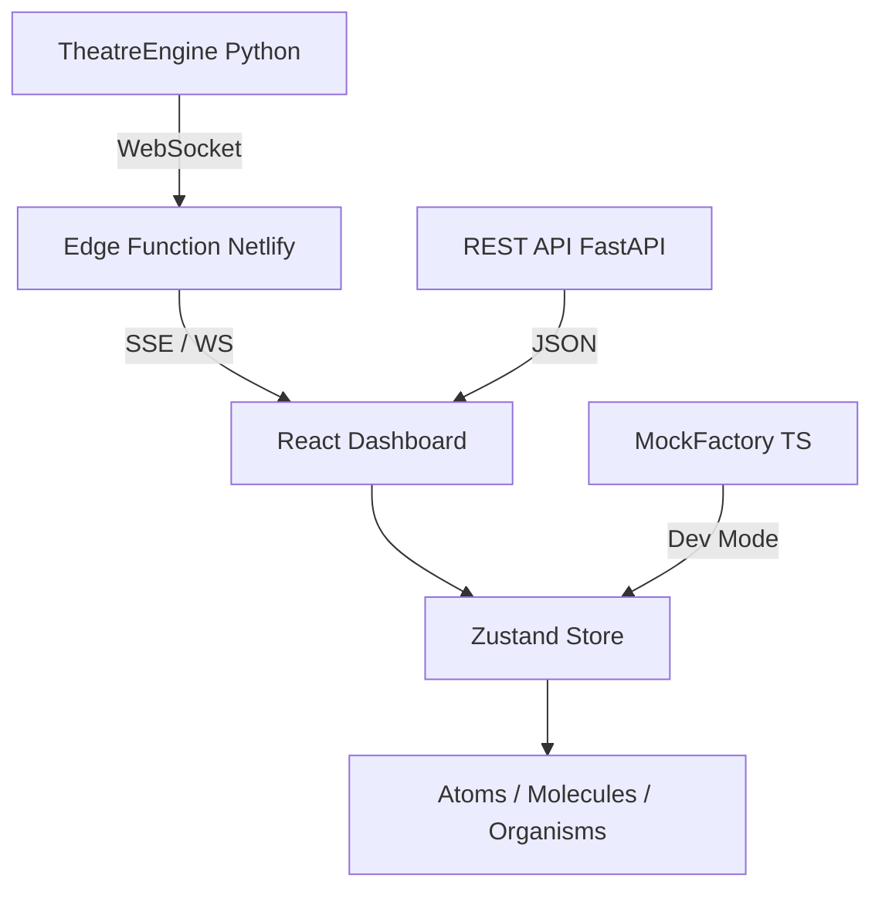

# Web TUI Architecture — Feature Driven Design (FDD)

> **Projeto:** PetroShield AxeGuard v2.6  
> **Escopo:** Especificação arquitetural para port do TUI Python (Textual/Rich) para Web (React/Vue/Node).  
> **Metodologia:** Atomic Design + Feature Driven Design + Domain-Driven Data Contracts.

---

## 1. Visão Geral

O TUI atual (`scripts/dlp_proxy/demo_ui.py`) roda no terminal usando Python Textual + Rich. Para escalabilidade e acesso C-Level, propomos um **Web TUI** que preserva a densidade informacional e a estética cyberpunk, mas roda em qualquer browser moderno.

### Por que Web TUI?
- **Acessibilidade:** CTOs e avaliadores SENAI não precisam instalar Python.
- **Real-time:** WebSocket para eventos ao vivo do Theatre Engine.
- **Escalabilidade:** 10.000+ dispositivos renderizados via virtualização.
- **Deploy:** Netlify / Vercel / CloudFront em segundos.

---

## 2. Metodologia: Atomic Design

Decompomos a UI em 4 níveis hierárquicos:

```text
Atoms        → Tokens, Labels, Status Indicators, Sparklines
Molecules    → Metric Cards, Torch Animation, Workflow Steps, Progress Rings
Organisms    → Event Streams, Playbook Tables, OKR Trackers, Fleet Grids
Templates    → 3-Pane Dashboard, Operations Console, Theatre Stage, Analytics Wall
```

---

## 3. Atoms

### 3.1 Semantic Tokens
```ts
const TOKENS = {
  neonGreen:  "#00FF41",   // Online, Success, Primary
  fireOrange: "#FF6200",   // Warning, Active, Energy
  deepVoid:   "#0A0A0A",   // Background
  cyan:       "#00FFFF",   // Info, Secondary
  amber:      "#FF9500",   // Caution
  alertRed:   "#FF3333",   // Critical, Error
  purple:     "#BF00FF",   // Telemetry, Trace
};
```

### 3.2 Typography
- **Display:** VT323 (Google Fonts) — títulos e banners
- **Body:** JetBrains Mono or Fira Code — métricas e tabelas
- **Scale:** `xs(12px) → sm(14px) → base(16px) → lg(20px) → xl(28px) → 2xl(40px)`

### 3.3 Status Indicators
```ts
interface StatusDotProps {
  level: "online" | "warning" | "critical" | "offline";
  pulse?: boolean; // animação para online
}
```

---

## 4. Molecules

### 4.1 Metric Card
```ts
interface MetricCardProps {
  title: string;
  value: string | number;
  delta?: string;       // "+12% vs mês passado"
  deltaType?: "positive" | "negative" | "neutral";
  icon?: string;        // Lucide icon name
  color?: PetroColor;
  sparkline?: number[]; // últimos 30 pontos
}
```

**Layout:**
```
┌─────────────────────────┐
│ [icon] Title            │
│                         │
│ [value]                 │
│ ▁▂▄▆█ sparkline         │
│ [delta]                 │
└─────────────────────────┘
```

### 4.2 Torch Animation (WebGL/CSS)
- **v1 CSS:** ASCII art com keyframes (fallback)
- **v2 WebGL:** Partículas de fogo em shader fragment simples
- **v3 Lottie:** Export do After Effects (opcional)

### 4.3 Workflow Stepper
```ts
interface WorkflowStepProps {
  phases: ["MONITOR", "DETECT", "ANALYSE", "RESPOND", "HUNT", "LESSONS"];
  activeIndex: number;
  completedColor?: string;
}
```

---

## 5. Organisms

### 5.1 Event Stream (Live Log)
```ts
interface EventStreamProps {
  events: IEvent[];
  maxRows?: number;
  highlightPatterns?: RegExp[];
  autoScroll?: boolean;
}
```
- **Virtualização:** react-window ou @tanstack/virtual
- **Highlight:** Regex para CPF, Poço, Credencial → cores de DLP

### 5.2 Playbook Table
```ts
interface PlaybookTableProps {
  workflows: IAgenticWorkflow[];
  onSelect: (id: string) => void;
  onRun: (id: string) => void;
}
```
- **Colunas:** ID | Nome | Trigger | SLA | Status | Ação
- **Row Actions:** Run, Edit, Clone, Export JSON

### 5.3 OKR Tracker
```ts
interface OKRTrackerProps {
  okrs: IOKRSet[];
}
```
- **Visual:** Progress bar segmentada + donut chart para progress_pct
- **Cores:** Verde (on_track) → Âmbar (at_risk) → Vermelho (behind)

### 5.4 Fleet Grid
```ts
interface FleetGridProps {
  nodes: IEdgeNode[];
  groupBy?: "region" | "status" | "vaccine_status";
  onNodeClick?: (node: IEdgeNode) => void;
}
```
- **Visual:** CSS Grid com cards de node
- **Filter:** Fuzzy search + multi-select tags
- **Bulk Actions:** Vaccinate selected, Remote wipe, Restart ruleset

---

## 6. Templates (Page Layouts)

### 6.1 Dashboard Template (3-Pane Grid)
```
┌──────────────────────────────────────────────┐
│ Header: PetroShield AxeGuard v2.6            │
├──────────────┬──────────────┬────────────────┤
│              │  Metric Cards│                │
│   Torch      │  (6 cards)   │   Mini Stats   │
│  Animation   ├──────────────┤                │
│              │ Agentic Loop │                │
├──────────────┼──────────────┼────────────────┤
│ Triple Surf  │ Compliance   │ Vendor Spotl   │
├──────────────┴──────────────┴────────────────┤
│ Event Stream — Live (RichLog)                │
└──────────────────────────────────────────────┘
```

**Grid CSS:**
```css
.dashboard-grid {
  display: grid;
  grid-template-columns: 280px 1fr 280px;
  grid-template-rows: auto auto 1fr auto;
  gap: 1rem;
  height: 100vh;
  background: var(--deepVoid);
}
```

### 6.2 Operations Template
- **Left:** Playbook Table (40%)
- **Center:** Workflow Inspector / State JSON (35%)
- **Right:** Live Log + Run Controls (25%)

### 6.3 Theatre Template
- **Stage:** Cena ativa com narração typewriter
- **Controls:** Play / Pause / Step / Reset
- **Timeline:** Visualização do grafo agentic (React Flow ou Cytoscape.js)
- **Metrics:** KPIs em tempo real da simulação

### 6.4 Analytics Template
- **Top:** Date range picker + Export CSV/PDF
- **Left:** Financial charts (Recharts/Victory)
- **Center:** Trend lines + Anomaly detection highlights
- **Right:** Fleet health radar chart

---

## 7. Stack Tecnológico Recomendado

| Camada | Opção A (Recomendada) | Opção B |
|--------|----------------------|---------|
| Framework | React 18 + Vite | Vue 3 + Vite |
| Estado | Zustand | Pinia |
| Query | TanStack Query | SWR |
| UI Kit | shadcn/ui + Tailwind | PrimeVue + Tailwind |
| Charts | Recharts + Tremor | Victory |
| Graph | React Flow | Cytoscape.js |
| Terminal | xterm.js (embedded) | - |
| Build | Bun / Vite | Bun / Vite |
| Deploy | Netlify | Vercel |

---

## 8. Data Flow Architecture



---

## 9. Performance Budget

- **First Contentful Paint:** < 1.5s (Netlify Edge)
- **Time to Interactive:** < 3s
- **Bundle Size:** < 200KB (gzip) initial
- **Virtualized List:** 10.000 rows @ 60fps
- **WebSocket Latency:** < 50ms (theatre events)

---

*Documento gerado como parte da Fase 3 de Blueprinting Arquitetural — PetroShield AxeGuard v2.6*
