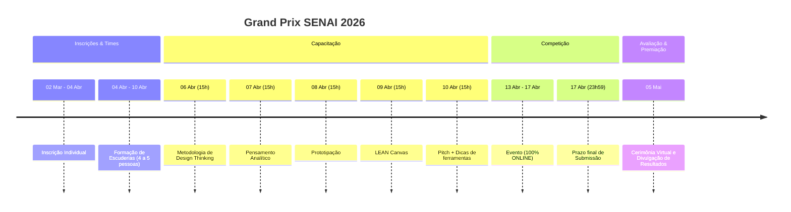
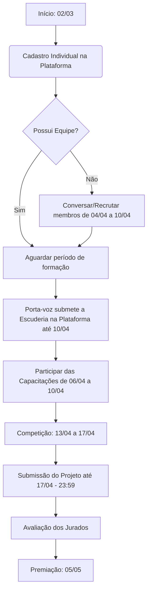

# Hackathon OS: Grand Prix SENAI 2026

## Sobre o Evento

O Grand Prix SENAI 2026 é uma competição de inovação aberta que une criatividade, colaboração e empreendedorismo para enfrentar desafios reais propostos por empresas e organizações. Em um formato dinâmico, as equipes trabalham em ciclos de ideação, desenvolvimento e entrega, gerando soluções aplicáveis que podem se transformar em protótipos, modelos de negócio e pitches de impacto.

Com foco em experiências práticas e na integração entre participantes de diferentes formações, o GP é uma oportunidade de colocar em prática métodos de inovação, fortalecer competências e construir portfólios relevantes para o mercado.

**🏁 Foco Oficial da Escuderia:** Cibersegurança e Ética Digital (Art 3.1, 'c'). Nossa premissa envolve arquitetura imaculada, hacking virtuoso, métricas C-Level e "Vendor Lock-in de competência".

**Formato:** 100% Online, permitindo a participação de qualquer cidade ou estado do Brasil.

---

## 📅 Timeline do Evento

---

## ⚙️ Regras e Funcionamento

### Formação de Escuderias

- Mínimo de **4 (quatro)** e máximo de **5 (cinco)** alunos.
- Regularmente matriculados nas respectivas Instituições de Ensino.
- Inscrição individual obrigatória antes da formação da equipe.
- O(a) porta-voz submete a escuderia na plataforma no período estipulado.

### Fluxograma do Participante

---

## 👥 Público-Alvo: Quem pode participar?

Estudantes com **15 anos ou mais** matriculados em:

- SENAI
- SESI
- Escolas Públicas
- Escolas Privadas

*(Menores de 18 anos precisam de autorização dos responsáveis).*

### Cursos Elegíveis

- Ensino Médio, Aprendizagem Industrial, Qualificação, Aperfeiçoamento, Técnico, Graduação Tecnológica, Bacharelado, Licenciatura, Especialização.

---

## 🏆 Premiação

1. **1º Lugar**
   - Medalhas Equipe, Troféu Escola
   - Prêmio Surpresa (Exclusivo por temática. Oferecido pela indústria parceira)

2. **2º Lugar**
   - Medalhas Equipe, Troféu Escola

3. **3º Lugar**
   - Medalhas Equipe, Troféu Escola

### Destaque Institucional

Troféus para escolas com melhor desempenho geral:

- ⭐️ Melhor Escola SENAI
- ⭐️ Melhor Escola SESI
- ⭐️ Melhor Escola Pública
- ⭐️ Melhor Escola Privada

### Certificação Oficial

Certificados digitais personalizados para todos os participantes, mentores e avaliadores.
