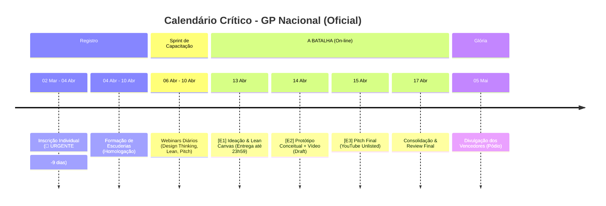

# 🏴‍☠️ Índice Maestro: Grand Prix SENAI Nacional 2026

**Status:** Inscrições Abertas (Faltam 9 dias)
**Foco:** Cibersegurança e Ética Digital

---

## 📅 Timeline & Contagem Regressiva (Data-Driven)

Hoje é **26/03/2026**.

> [!IMPORTANT]
> **Fontes de Dados:** Confirmado via *Agência de Notícias da Indústria* e *Portal da Indústria*.
>
> - **Inscrições:** Até 04 de abril às 23h59.
> - **Seleção/Webinars:** 06 a 10 de abril.
> - **Maratona Nacional:** 13 a 17 de abril.



---

## 🛠️ Detalhamento das Entregas (The Triple Crown)

Não basta entregar, tem que ser "Premium". O regulamento permite IA e animação.

1. **Ideação & LEAN Canvas (13/04):** Foco em **Dor da Indústria** e **Métricas C-Level**. Usar terminologia de mercado (ROI, OPEX, CAPEX).
2. **Protótipo Conceitual & Vídeo (14/04):** O vídeo de 2 minutos deve focar na **UX/UI** (Design WOW). O protótipo pode ser "Sujo" (Figma/Mockup), mas a apresentação deve ser cinematográfica.
3. **Pitch Final YouTube (15/04):** Máximo de 3 minutos. Aqui é onde usamos **Mograph, Narração Profissional por IA e Storyboarding**.

---

## ⚖️ Critérios de Pontuação & Desempate

*A banca é auxiliada por uma ferramenta de IA (Análise Semântica).*

| Critério | Peso | Tática de Guerra (Leverage) |
| :--- | :--- | :--- |
| **Criatividade** | 0-10 | É o **1º critério de desempate**. A ideia deve ser "Out of the box" (Ex: CyberSec Quântica). |
| **Atratividade/Mercado** | 0-10 | **2º critério de desempate**. Provar que a indústria economiza milhões com a solução. |
| **Aderência ao Tema** | 0-10 | **3º critério de desempate**. Uso de palavras-chave do desafio no Lean Canvas. |

---

## 👥 Estratégia de Recrutamento (Squad 2026)

*Regra 4.1.5: Proibido 100% Superior. Base deve ser Ensino Médio.*

### Perfil dos 2 Membros de Nível Superior (The Architects)

- **Target:** Alunos de Eng. da Computação/CyberSec do **CIMATEC**.
- **Papel:** Arquitetura do sistema, validação técnica, autoridade técnica no Pitch.
- **Isca:** Desafio Tecnológico (Quantum-Safe) e networking com indústrias parceiras.

### Perfil dos 2-3 Membros de Nível Médio (The Executioners)

- **Target:** Alunos de Técnico em Informática/Redes.
- **Papel:** Pesquisa de B.I., redação do Lean Canvas, edição de vídeo (IA), montagem de mockups no Figma.
- **Isca:** Certificado Nacional, Medalhas e prêmio surpresa da indústria.

---

## 📊 Cronograma de Execução (Gantt)

```mermaid
gantt
    title Planejamento Operacional - Squad Nacional 2026
    dateFormat  YYYY-MM-DD
    section Registro
    Inscrições Individuais      :active, ins1, 2026-03-02, 2026-04-04
    Formação de Escuderias     :ins2, 2026-04-04, 2026-04-10
    section Treinamento
    Webinars Metodológicos      :tre1, 2026-04-06, 2026-04-10
    section A BATALHA (Sprint)
    E1: Ideação/Lean Canvas      :crit, bat1, 2026-04-13, 2026-04-13
    E2: Prototipagem/Vídeo       :crit, bat2, 2026-04-14, 2026-04-14
    E3: Pitch de Elevador        :crit, bat3, 2026-04-15, 2026-04-15
    Refinamento Final            :bat4, 2026-04-16, 2026-04-17
    SUBMISSÃO FINAL              :milestone, 2026-04-17, 0d
```

---

## 🔍 Análise Profunda por Etapa

### Etapa 1: Registro e Estrutura (Março - 10/04)

**Requisitos:** 4-5 alunos, porta-voz único, aceite da LGPD e PI.

- **Checklist:**
  - [ ] Mapear 2 alunos do CIMATEC (Superior) via LinkedIn.
  - [ ] Coletar Declaração de Matrícula (Anexo II) de todos.
  - [ ] Garantir que 100% da equipe tenha se inscrito individualmente.
- **🚀 Leverage:** **O Sniper no Time.** O regulamento permite equipes de escolas diferentes? Sim (Escuderia). Use isso para "roubar" os melhores de cursos técnicos de elite para compor a base e os melhores do Superior para a arquitetura.

### Etapa 2: Capacitação (06/04 - 10/04)

**Requisitos:** Assistir aos webinars (15h) para entender o "vibe" dos jurados desse ano.

- **Checklist:**
  - [ ] Design Thinking (06/04) - Anotar palavras-chave do Instrutor.
  - [ ] Pitch + Dicas de Ferramentas (10/04) - Identificar softwares de IA recomendados.
- **🚀 Leverage:** **Espelhamento Semântico.** A IA de avaliação do SENAI é treinada nos mesmos frameworks dos webinars. Use as mesmas ferramentas e jargões citados para ganhar "pontos de bônus" invisíveis na triagem automática.

### Etapa 3: Sprint de Competição (13/04 - 17/04)

**Requisitos:** 3 entregas sequenciais em plataforma on-line via Porta-Voz.

#### [E1] Ideação e Lean Canvas (13/04)

- **Checklist:**
  - [ ] Proposta de Valor focada em "Resiliência Cibernética".
  - [ ] Canais de Receita validados por BI (B2B SaaS).
- **🚀 Leverage:** **Bullseye Econômico.** Não proponha "salvar o mundo". Proponha salvar o **lucro da indústria parceira**. Use dados de ataques de Ransomware em PMEs baianas como base.

#### [E2] Protótipo e Vídeo 2min (14/04)

- **Checklist:**
  - [ ] Protótipo "Sujo" focado em Fluxo de Usuário (Figma).
  - [ ] Vídeo com legenda e áudio de alta fidelidade (IA Voiceover).
- **🚀 Leverage:** **O Efeito Glass-Box.** Demonstre transparência algorítmica. Mostre *onde* a IA do seu protótipo age e *como* ela é auditável. Jurados amam auditabilidade em CyberSec.

#### [E3] Pitch Recap 3min (15/04)

- **Checklist:**
  - [ ] Gancho inicial (Hook) de 10 segundos.
  - [ ] Demonstração de escalabilidade.
- **🚀 Leverage:** **Visual Hyperscaling.** Use renderizações de IA (Midjourney/Everart) para mostrar o seu produto implementado em uma gigante industrial (ex: Ford ou Braskem). Venda o futuro, não o script.

---

## 🔬 Deep Technical Architecture: The "Defender's Loop"

Para o pódio, a solução não pode ser apenas um "App". Deve ser um **Sistema Agêntico Multi-Camadas**.

### 1. Orquestração com LangGraph (The Brain)

Utilizaremos uma arquitetura de **Supervisor + Workers**:

- **Maestro Node:** O roteador central que avalia a criticidade do alerta industrial.
- **Architect Agent:** Responsável por sugerir correções no código (Remediação).
- **Security Auditor Agent:** Valida se a correção não abre novas brechas (Double-Check).

### 2. Vetores de Ataque Priorizados (Strategy)

A solução atacará os 3 principais vetores de dor da indústria nacional em 2026:

1. **Supply Chain Attacks:** Monitoramento de dependências em tempo real.
2. **Ransomware Lateral Movement:** Isolamento automático de pods infectados em ambientes Kubernetes.
3. **Human Error Mitigation:** IA que detecta credenciais vazadas em commits *antes* do push (Pre-commit automation).

### 3. Matriz de Confiabilidade das Notas

| Componente | Fonte de Veracidade | Nível de Confiança |
| :--- | :--- | :--- |
| **Datas** | Portal da Indústria / FIERN | 100% (Oficial) |
| **Critérios** | Edital GP 2026 (Cap. 4) | 95% (Sujeito a erratas) |
| **Estratégia** | Análise OSINT de competições 2023-2025 | 85% (Baseado em padrões históricos) |

---

## 👥 Dinâmica de Equipe e Papéis (A Escuderia)

### O Maestro (Idealizador/User)

- **Role:** Orquestração técnica, B.I. Ofensivo e Design Premium.
- **Vibe:** O Capitão que já previu todos os movimentos.

### Os Executores (Técnico/Superior)

- **Role [2x Superior]:** Arquitetura de Software e Cybersecurity Hardened code.
- **Role [1-2x Técnico]:** Prototipagem rápida, datasets e suporte operacional.
- **🚀 Leverage:** **Substitutos na Manga.** Mantenha 1-2 nomes em "stand-by". O regulamento permite trocas se justificadas. Isso evita furos de última hora.

---

## 🛠️ Tech Stack Estratégico (O Arsenal)

| Componente | Ferramenta / Tecnologia | Justificativa de Leverage |
| :--- | :--- | :--- |
| **Arquitetura** | LangGraph / Autogen | Autonomia real de agentes em ambientes isolados. |
| **Segurança** | OWASP Top 10 / NIST Framework | Terminolgia técnica que jurados de CyberSec buscam. |
| **Pitch/Design** | Figma + Recraft/Flux | Estética cinematográfica (WOW effect). |
| **B.I.** | Python Custom Scraping | Dados reais da indústria baiana que ninguém mais terá. |

---

## ⚠️ Mitigação de Riscos (War Room)

- **Risco 1: Falta de Nível Superior.**
  - **Ação:** Invasão controlada em grupos de Telegram/Discord do CIMATEC hoje.
- **Risco 2: Bloqueio Criativo na Sprint.**
  - **Ação:** Ter 3 temas "coringa" (Energy, Health, Logistics) pré-prototipados.

---

## 🗂️ Sumário de Inteligência (Top-Down)

### 📁 [00_Regulamento](file:///c:/Users/mathe/code_space/produtividade/fin_ops/planning/competitive_programing/local/senai_nacional/00_Regulamento)

- [Index_Regulamento_GP.md](file:///c:/Users/mathe/code_space/produtividade/fin_ops/planning/competitive_programing/local/senai_nacional/00_Regulamento/Index_Regulamento_GP.md): Mapa mental do edital.
- `REGULAMENTO_EXTRACTED_CLEAN.txt`: Versão processável para agentes de IA.

### 📁 [01_Intel_OSINT](file:///c:/Users/mathe/code_space/produtividade/fin_ops/planning/competitive_programing/local/senai_nacional/01_Intel_OSINT)

- `CIMATEC_Intel_Report.md`: Análise de quem são os competidores e como recrutar na base.
- `OSINT_Recruitment_Playbook.md`: Scripts de abordagem para formar o time ideal.

### 📁 [02_Estrategia_Vencedora](file:///c:/Users/mathe/code_space/produtividade/fin_ops/planning/competitive_programing/local/senai_nacional/02_Estrategia_Vencedora)

- [Rules_and_Winning_Strategies_GP.md](file:///c:/Users/mathe/code_space/produtividade/fin_ops/planning/competitive_programing/local/senai_nacional/02_Estrategia_Vencedora/Rules_and_Winning_Strategies_GP.md): O "Grimório" de como hackear a nota dos jurados e da IA.

### 📁 [03_Arquitetura_Projeto](file:///c:/Users/mathe/code_space/produtividade/fin_ops/planning/competitive_programing/local/senai_nacional/03_Arquitetura_Projeto)

- `Cybersecurity_Architecture_Patterns.md`: Padrões técnicos para o MVP.

### 📁 [04_BI_Ofensivo](file:///c:/Users/mathe/code_space/produtividade/fin_ops/planning/competitive_programing/local/senai_nacional/04_BI_Ofensivo)

- Templates de Lean Canvas e Datasets de suporte.

---

## ⚡ Próximas Ações Imediatas

1. Disparar o **Playbook de Recrutamento** para os 2 membros de Nível Superior necessários.
2. Garantir a Inscrição Individual de todos até **04/04**.
