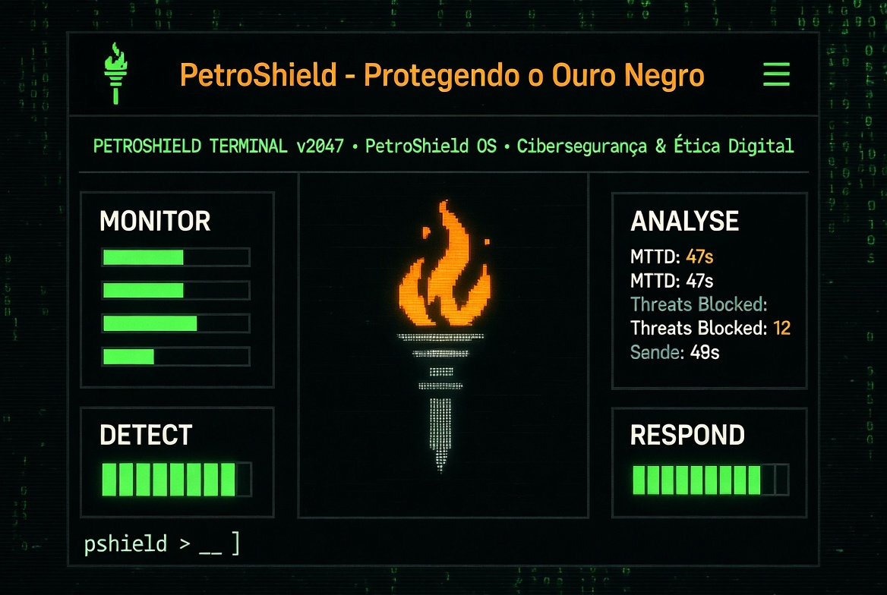
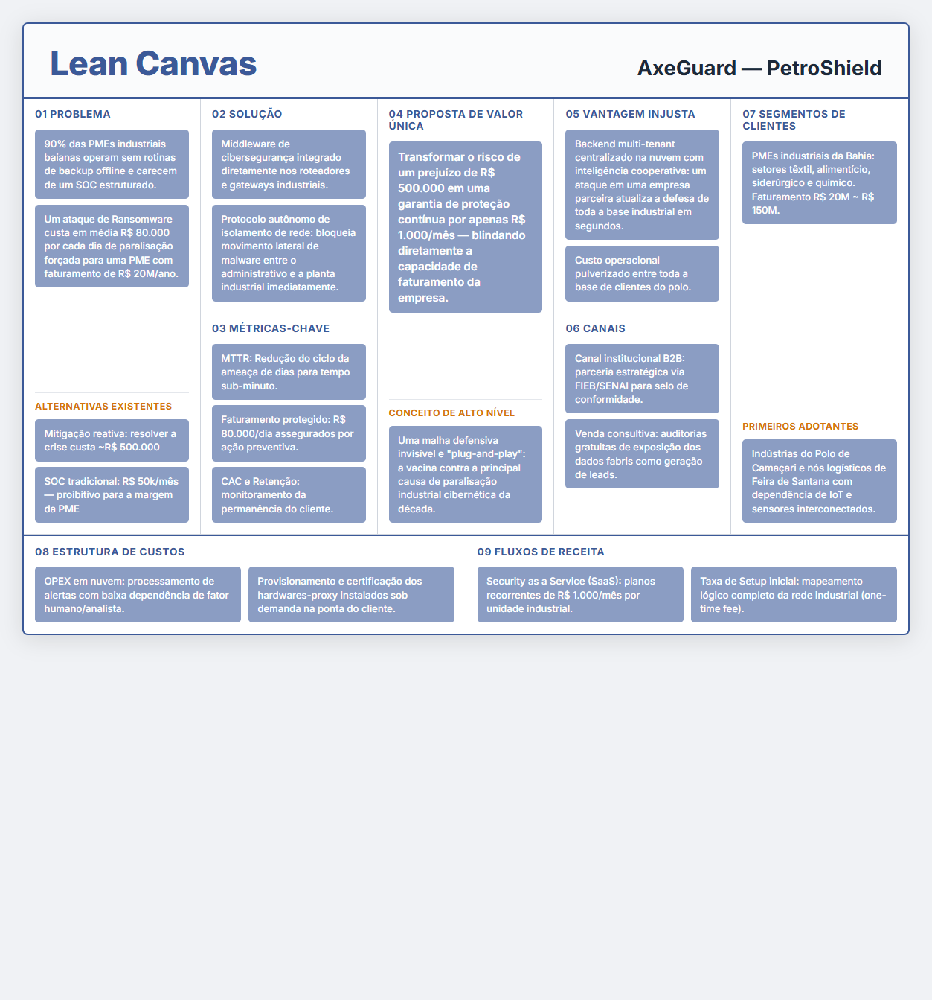

# 🏴‍☠️ Central de Inteligência: GP SENAI 2026

## 📡 Mission Status: STAGE E1 - COMPLETED
> [!TIP]
> **Status:** `ACTIVE_SOC_MODE` | **Deadline E1:** `SUBMITTED` | **Next:** `CONCEPTUAL_PROTOTYPE (E2)`

---

## 🛡️ O Projeto: AxeGuard — PetroShield
O **AxeGuard** é o motor central do ecossistema PetroShield. Um **Middleware de Cibersegurança Adaptativo (Zero-Trust)** desenhado para blindar a infraestrutura industrial de PMEs contra o sequestro de faturamento por Ransomware.

### ⚡ Key Value Proposition
*   **Isolamento Autônomo:** Bloqueio imediato de movimento lateral.
*   **Custo Zero de Implementação:** Escaneamento e conformidade B2B.
*   **Inteligência Cooperativa:** Se uma rede cai, todas as outras sobem as defesas.

---

## 🖼️ Lean Canvas (AxeGuard)
Abaixo, o quadro estratégico que define o modelo de negócios e a viabilidade econômica da solução.

---

## 📂 Arsenal & Repositório (Directory Map)

### 📊 [06] Entregas Oficiais (GP Nacional)
**Onde o pódio é construído.**
- **[E1_Entrega_Final.md](06_Entregas/E1_Ideacao/E1_Entrega_Final.md)**: Documento final de ideação submetido.
- **[Lean Canvas Board](base/reqs/lean_canvas_axeguard.html)**: Versão interativa do board.

### 📑 [00] Regulamento & Governança
- **[Index_Regulamento_GP.md](00_Regulamento/Index_Regulamento_GP.md)**: Guia rápido de regras e critérios de pontuação.

### 🕵️ [01] Intel & OSINT
- **[Petrobras_Supply_Chain_Intelligence.md](01_Intel_OSINT/Petrobras_Supply_Chain_Vendor_Intelligence.md)**: Mapeamento de fragilidades industriais.

### 🧠 [03] Arquitetura & Código
- **[Technical_Specs.md](03_Arquitetura_Projeto/Technical_Specs_and_Strategic_Planning.md)**: Definição da stack (LangGraph, OTEL, Agents).
- **[Cybersecurity_Patterns.md](03_Arquitetura_Projeto/Cybersecurity_Architecture_Patterns.md)**: Padrões defensivos industriais.

### 📈 [05] Market Intelligence
- **[Executive_Summary_Economics.md](05_Market_Intelligence/Executive_Summary_Cyber_Economics.md)**: O ROI de 358% validado por BI.

---

## 🖥️ TUIs Node/TypeScript + Bun (Outer Instances)
Protótipos de terminal independentes para demonstração local e deploy contínuo.
- **[outer-tui-axeguard-ts](outer-tui-axeguard-ts/)** — Dashboard SOC com `ink` (React no terminal)
- **[outer-tui-classic-ts](outer-tui-classic-ts/)** — Terminal cyber-ops com `blessed`
- **Deploy:** [petroshield-app.netlify.app](https://petroshield-app.netlify.app) | [petroshield-classic.netlify.app](https://petroshield-classic.netlify.app)
- **Setup CI/CD:** veja [TUI_NETLIFY_SETUP.md](TUI_NETLIFY_SETUP.md)

## ⚓ Links Rápidos
| Link | Descrição |
| :--- | :--- |
| **[Hackathon OS](Hackathon%20OS.md)** | Nosso sistema de gestão de tempo e sprints. |
| **[Plataforma SENAI](https://grandprix.decocms.com)** | Site oficial para submissão dos entregáveis. |

---
*Generated by Antigravity | Cyber-Sec Ops Unit 2026*
