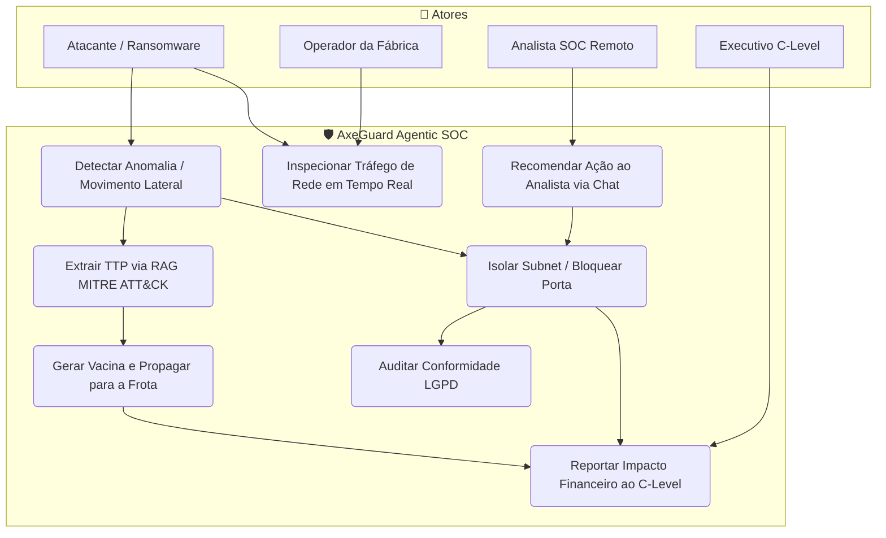
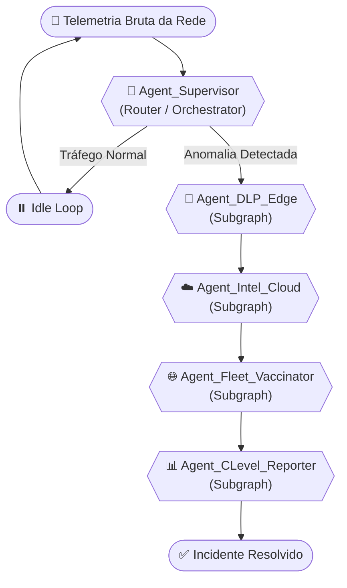
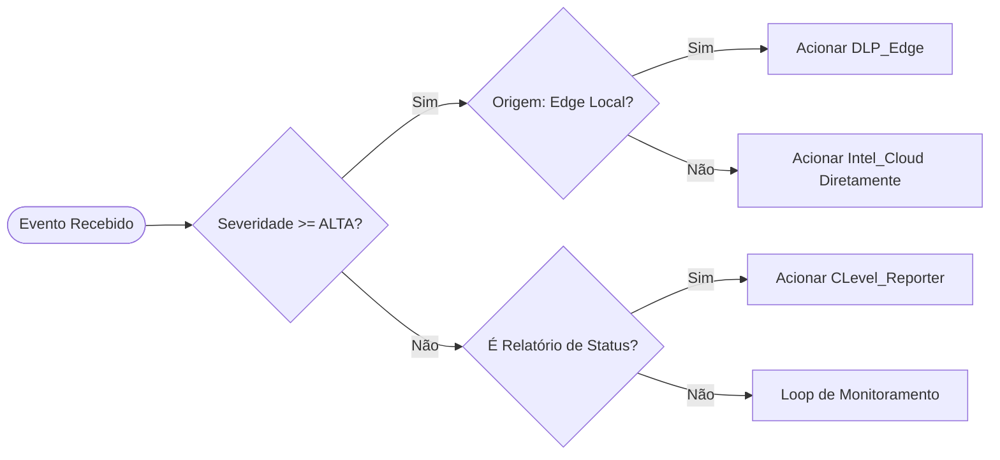
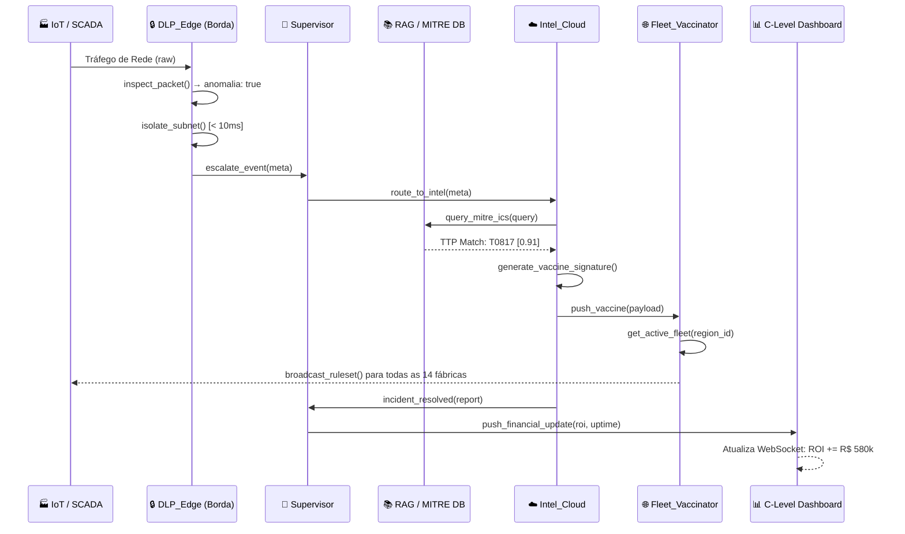
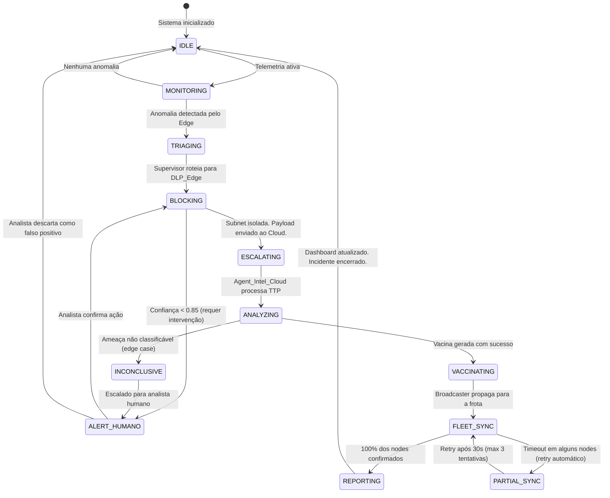

# 📐 Documentação Técnica de Planejamento
# Sistema: AxeGuard DLP — Agentic SOC PetroShield

**Classificação:** Documento Interno de Arquitetura — SENAI Grand Prix 2026  
**Versão:** 1.0 — Fase E2 (Prototipagem Conceitual)  
**Data:** 14/04/2026

---

## Sumário

1. [Visão Geral da Solução](#1-visão-geral-da-solução)
2. [Diagrama de Caso de Uso](#2-diagrama-de-caso-de-uso)
3. [Topologia de Orquestração de Agentes](#3-topologia-de-orquestração-de-agentes)
4. [Toolkits por Agente](#4-toolkits-por-agente)
5. [Fluxos de Dados e Context Engineering](#5-fluxos-de-dados-e-context-engineering)
6. [Mapeamento de Estados do Grafo (LangGraph)](#6-mapeamento-de-estados-do-grafo-langgraph)
7. [Subgrafos e Rotinas Pré-Programadas](#7-subgrafos-e-rotinas-pré-programadas)
8. [Dataviz e Camadas de Interface](#8-dataviz-e-camadas-de-interface)
9. [Fronteiras de Escopo (O Que NÃO Construímos)](#9-fronteiras-de-escopo)

---

## 1. Visão Geral da Solução

O **AxeGuard** é o nó protagonista de um **Agentic SOC** (Security Operations Center Agêntico) chamado **PetroShield**. Ele não é um produto isolado — é o **middleware central** de um grafo de inteligência distribuída, onde múltiplos agentes autônomos coordenam a defesa de uma rede industrial de PMEs, abolindo a necessidade de analistas humanos on-call 24/7.

### Premissa Central

> *Substituir a reação humana lenta e cara por uma resposta agente imediata e barata, operando dentro do paradigma Zero-Trust na borda da rede (Edge Computing).*

### Pilares Arquiteturais

| Pilar | Descrição | Tecnologia de Referência |
| :---- | :---- | :---- |
| **Zero-Trust Edge** | Nenhum pacote de rede é confiável por default. Toda comunicação é inspecionada no gateway. | Envoy Proxy / eBPF |
| **DLP em Borda** | Data Loss Prevention ocorre localmente, sem depender de conectividade com a nuvem. | Custom Middleware (Python FastAPI) |
| **Orquestração Agêntica** | Um grafo de agentes coordenados trata, escalona e resolve incidentes com autonomia. | LangGraph / AutoGen (Simulado) |
| **Inteligência Cooperativa** | Um evento blocqueado em uma PME alimenta a defesa de todo o polo industrial. | Multi-tenant Cloud Backend |
| **Transparência (Glass-Box)** | O TUI e o Dashboard executivo expõem o raciocínio interno dos agentes em tempo real. | WebSocket + Reactive UI |

---

## 2. Diagrama de Caso de Uso

Todos os atores que interagem com o sistema e suas respectivas jornadas.



---

## 3. Topologia de Orquestração de Agentes

A arquitetura agêntica é um **Grafo Direcionado** (à la LangGraph) com um nó Supervisor central e subgrafos especializados. O fluxo de dados e decisões segue a topologia abaixo.

### 3.1 Grafo Principal (Supervisor Graph)



### 3.2 Papéis dos Nós

| Agente | Tipo | Responsabilidade Principal |
| :--- | :--- | :--- |
| `Agent_Supervisor` | Router / Orquestrador | Recebe telemetria, classifica eventos e distribui para o subgrafo correto. Nunca executa ações diretas. |
| `Agent_DLP_Edge` | **Protagonista (Middleware)** | Inspeção profunda de pacotes (DPI) na borda. Zero-Trust actioning. Executa isolamento da subnet em até 10ms. |
| `Agent_Intel_Cloud` | Analista de Ameaças | Processa o payload do ataque bloqueado via RAG + IA. Classifica o TTP (MITRE) e sintetiza a "vacina" (assinatura de bloqueio). |
| `Agent_Fleet_Vaccinator` | Propagador | Distribui a assinatura de vacina para todos os nós Edge da frota multi-tenant. |
| `Agent_CLevel_Reporter` | Tradutor Executivo | Converte o evento técnico em linguagem de negócio (ROI, Downtime Evitado, Status LGPD) e atualiza o Dashboard. |

---

## 4. Toolkits por Agente

Cada agente possui um contexto de sistema, ferramentas e capacidades de memória definitivos.

---

### 🔴 `Agent_DLP_Edge` — O Middleware Protagonista

**System Prompt Base:**
```
Você é a camada de defesa de borda do PetroShield. Opera no gateway industrial
da fábrica parceira. Sua diretriz é ZERO TOLERÂNCIA. Qualquer padrão de tráfego
não catalogado no contexto de operação normal (Modbus, OPC-UA, DNP3) deve ser 
bloqueado proativamente. Latência máxima de resposta: 10ms. Aja, depois reporte.
```

**Ferramentas (Tools):**
| Ferramenta | Assinatura | Descrição |
| :--- | :--- | :--- |
| `inspect_packet(ip, port, payload)` | → `dict` | Decodifica o cabeçalho e payload do pacote suspeito. |
| `query_signature_db(payload_hash)` | → `ThreatMatch \| None` | Compara com a base local de assinaturas de malware (cache local). |
| `block_port(ip, port)` | → `bool` | Instrui o roteador de gateway a fechar a porta imediatamente. |
| `isolate_subnet(subnet_cidr, strict)` | → `bool` | Isola a sub-rede da planta industrial do segmento administrativo. |
| `escalate_to_cloud(payload_meta, threat_context)` | → `Event` | Empacota metadados do ataque e envia para `Agent_Intel_Cloud`. |

**Prompt Chain (Fluxo Padrão de Detecção):**
```
[OBSERVAÇÃO] Receber pacote de tráfego suspeito
       ↓
[RACIOCÍNIO] Este pacote respeita os protocolos industriais catalogados?
       ↓
  [SIM] → Permitir (Idle Loop)
  [NÃO] → Executar `query_signature_db(hash)` 
              ↓
         Match Encontrado? 
         [SIM] → Executar `block_port()` + `isolate_subnet()` + `escalate_to_cloud()`
         [NÃO] → Executar `block_port()` (proativo) + `escalate_to_cloud()` {unknown_threat: true}
```

**Memória:**
- **Curto Prazo (In-Context):** Últimos 50 eventos de tráfego da sessão.
- **Longo Prazo (RAG Local):** Base de assinaturas de ameaças sincronizadas via Fleet Vaccinator.

---

### 🧠 `Agent_Supervisor` — O Orquestrador

**System Prompt Base:**
```
Você é o Supervisor do grafo de agentes do PetroShield. Seu único papel é
ROTEAR. Você recebe eventos brutos de telemetria e decide qual sequência de
subgrafos acionar. Não execute nenhuma ação de segurança diretamente.
Mantenha um log estruturado de cada evento roteado.
```

**Critério de Roteamento (Routing Logic):**



---

### ☁️ `Agent_Intel_Cloud` — O Analista de Ameaças

**System Prompt Base:**
```
Você é o analista de inteligência de ameaças do SOC AxeGuard. Você recebe
metadados de ataques bloqueados pelo Edge e sua missão é: (1) Classificar
o TTP usando MITRE ATT&CK for ICS. (2) Gerar um hash de vacina para prevenir
ataques similares em outras fábricas. Use raciocínio passo-a-passo (Chain of
Thought) visível antes de emitir qualquer ação.
```

**Ferramentas (Tools):**
| Ferramenta | Assinatura | Descrição |
| :--- | :--- | :--- |
| `query_mitre_ics(vector_query)` | → `list[TTP]` | Busca semântica (RAG) na base MITRE ATT&CK for ICS. |
| `query_threat_history(org_id)` | → `list[Incident]` | Recupera histórico de incidentes do tenant (memória longa). |
| `generate_vaccine_signature(ttp_profile)` | → `VaccinePayload` | Sintetiza um hash de regra de firewall para a frota. |
| `confidence_score(match_result)` | → `float` | Calcula confiança da classificação para acionar auto-response vs. alerta humano. |

**Cadeia de Raciocínio (ReAct Pattern):**
```
THOUGHT: Recebi payload com hash X de edge em 10.0.0.12.  
ACTION: query_mitre_ics("lateral movement SMB exploit")  
OBSERVATION: Top match: T0817 (Drive-by Compromise) + T0812 (Default Credentials). Sim: 0.91  

THOUGHT: Confiança acima de 0.85. Posso gerar vacina automaticamente.  
ACTION: generate_vaccine_signature({ttp: "T0817", port: 445, proto: "SMB"})  
OBSERVATION: VaccinePayload gerada. Hash: SHA256:ab9f32...  

THOUGHT: Vacina pronta. Acionar Fleet_Vaccinator para propagar.  
ACTION: escalate_to_fleet(vaccine_payload)  
```

---

### 🌐 `Agent_Fleet_Vaccinator` — O Propagador

**System Prompt Base:**
```
Você é responsável pela resiliência cooperativa do ecossistema PetroShield.
Ao receber uma VaccinePayload, sua missão é propagá-la com garantia de entrega
(at-least-once) para todos os Edge Nodes ativos da frota multi-tenant,
priorizando as fábricas do mesmo polo geográfico.
```

**Ferramentas:**
| Ferramenta | Assinatura | Descrição |
| :--- | :--- | :--- |
| `get_active_fleet(region_id)` | → `list[EdgeNode]` | Lista todos os nós Edge ativos da frota, filtráveis por região. |
| `push_ruleset(node_id, vaccine)` | → `DeliveryReceipt` | Envia a vacina para o Edge Node especificado via canal seguro. |
| `broadcast_to_fleet(region, vaccine)` | → `BroadcastReport` | Difunde a vacina para todos os nós de uma região em paralelo. |
| `verify_delivery(node_id, vaccine_hash)` | → `bool` | Confirma a recepção e aplicação da vacina no Edge remoto. |

---

### 📊 `Agent_CLevel_Reporter` — O Tradutor Executivo

**System Prompt Base:**
```
Você é a interface executiva do PetroShield. Não fale de IPs, portas ou
hashes. Traduza 100% dos eventos técnicos para linguagem de negócio:
ROI (Retorno sobre Investimento), Downtime Evitado, Risco Financeiro Mitigado
e Conformidade Regulatória (LGPD/ANPD). Compute os valores em Reais (BRL).
```

**Métricas Computadas:**
```python
# Modelo de Cálculo do Dashboard Executivo
CUSTO_DOWNTIME_HORA = 80_000 / 24           # R$ 3.333,33/hora
CUSTO_RECUPERACAO = 500_000                 # custo médio de remedição
ASSINATURA_MENSAL = 1_000                   # ticket do cliente

roi_salvo = horas_downtime_evitadas * CUSTO_DOWNTIME_HORA
risco_recuperacao_evitado = CUSTO_RECUPERACAO  # se evt. foi pre-ransomware
compliance_status = "LGPD: OK" if sem_vazamento else "ALERTA: Verificar Base"
roa = (roi_salvo / ASSINATURA_MENSAL) * 100  # Return on Assinatura (%)
```

---

## 5. Fluxos de Dados e Context Engineering

### 5.1 Fluxo de Dados Completo (End-to-End)



### 5.2 Context Engineering por Camada

O sistema gerencia 3 janelas de contexto independentes para manter coerência sem explodir o limite de tokens:

| Camada | Contexto Mantido | Estratégia |
| :--- | :--- | :--- |
| **Edge (Borda)** | Últimos 50 pacotes + configuração de rede local | In-memory (Redis-like) |
| **Intel Cloud** | Histórico de 30 dias de incidentes do tenant | Long-term Memory (Vector DB) |
| **Fleet** | Estado atual de todos os Edge Nodes + versão de ruleset | Shared State (PostgreSQL) |
| **Dashboard** | Métricas financeiras acumuladas da sessão | Reactive State (WebSocket) |

---

## 6. Mapeamento de Estados do Grafo (LangGraph)

Definição formal de todos os estados possíveis do sistema agêntico, permitindo o controle de transições sem ambiguidade.



---

## 7. Subgrafos e Rotinas Pré-Programadas

### 7.1 Rotina: `ZERO_TRUST_EDGE_CYCLE` (Rotina Central do Middleware)

Esta é a rotina mais crítica. Roda indefinidamente no Edge Node.

```
LOOP (intervalo: 100ms):
  1. [COLETA]     Capturar N pacotes do gateway (batch)
  2. [FILTRO]     Separar tráfego por protocolo (OPC-UA, Modbus, SMB, HTTP)
  3. [VALIDAÇÃO]  Para cada pacote fora do protocolo esperado da VLAN:
       a. Calcular hash do payload
       b. Consultar cache de assinaturas locais
       c. SE match_score > 0.80:  → EXECUTAR BLOQUEIO IMEDIATO
       d. SE match_score desconhecido: → BLOQUEIO PROATIVO + ESCALONAR
  4. [REPORTE]    Enviar telemetria limpa ao Supervisor (não-bloqueios)
END LOOP
```

### 7.2 Rotina: `RAG_INTEL_EXTRACTION` (Subgrafo de Análise)

```
INPUT: payload_meta {ip, port, hash, protocol, raw_bytes}

1. [EMBEDDING]    Converter payload em vetor semântico (modelo: text-embedding-3-small)
2. [RETRIEVAL]    Top-K=5 resultados da Vector DB MITRE ICS (similaridade cosseno)
3. [RERANKING]    Re-ordenar por relevância contextual (protocolo industrial + setor)
4. [SYNTHESIS]    LLM (GPT-4o / Gemini) gera:
                    - Classificação TTP (ex: T0817, T0801)
                    - Cadeia de ataque inferida (Kill Chain)
                    - Score de confiança (0-1)
5. [DECISION]
                    IF confiança >= 0.85: Auto-vaccinate
                    IF confiança 0.60-0.84: Vaccinate + Alerta Analista
                    IF confiança < 0.60: Hold + Alerta Urgente Humano
```

### 7.3 Rotina: `FLEET_VACCINATION_BROADCAST`

```
INPUT: vaccine_payload {hash, rule, ports_blocked, protocol}

1. [INVENTÁRIO]   Consultar registry de Edge Nodes ativos (region_filter: BAHIA)
2. [PRIORIZAÇÃO]  Ordenar frota:
                    (1) Mesmo polo geográfico do ataque
                    (2) Mesmo setor industrial
                    (3) Demais fábricas da rede
3. [BROADCAST]    Enviar vaccine_payload em paralelo (async) para todos os nodes
4. [ACK]          Aguardar confirmação de recebimento + aplicação (timeout: 5s)
5. [RETRY]        Nodes com timeout entram em fila de retry (max 3x, backoff exponencial)
6. [REPORT]       Gerar BroadcastReport: {total, success, failed, partial}
```

---

## 8. Dataviz e Camadas de Interface

A interface de demonstração é composta por **duas views complementares**:

### 8.1 TUI (Terminal User Interface) — Visão Tech Lead

**Propósito:** Revelar o raciocínio interno dos agentes ("Glass-Box Intelligence").  
**Paleta:** `#00FF41` (verde terminal) / `#FF3333` (alerta) / `#00F3FF` (sistema) sobre fundo `#050505`.

**Elementos do Terminal:**
- `[GRAPH: SUPERVISOR]` — Identificador do nó ativo no grafo
- `[Agent_DLP_Edge]` — Ações de bloqueio/isolamento
- `[RAG_Intel] THOUGHT:` — Chain of Thought visível
- `[TOOL_OUTPUT]` — Resultado das ferramentas executadas

### 8.2 Executive Dashboard (WebApp) — Visão C-Level

**Propósito:** Traduzir a operação técnica em impacto financeiro e conformidade.

**Cards Obrigatórios:**
| Card | Métrica | Atualização |
| :--- | :--- | :--- |
| Ameaças Ativas | Contagem + Severidade | Realtime via WebSocket |
| Downtime Evitado | Horas acumuladas | Por incidente resolvido |
| Faturamento Salvaguardado | R$ BRL | Animação counter em tempo real |
| Compliance LGPD | Verde / Alerta | Por evento de contenção |
| Frota Protegida | X de N fábricas vacinadas | Pós-broadcast |

---

## 9. Fronteiras de Escopo

> [!IMPORTANT]
> **O que este sistema DEMONSTRA vs. o que ele realmente IMPLANTA**
> Esta documentação descreve **um sistema de raciocínio e demonstração de alta fidelidade**, não um deploy de produção. Em uma apresentação real, o código simula os fluxos dos agentes via scripts JavaScript pré-temporizados.

### O que NÃO faremos (para caber no escopo do hackathon):

- ❌ Deploy real de agentes LLM em infraestrutura de produção
- ❌ Conexão com roteadores físicos ou SCADA/OT reais
- ❌ Banco de dados de vetor com embeddings reais (MITRE)
- ❌ Integração com SIEM real (Elasticsearch, Splunk)
- ❌ Autenticação OAuth / JWT para múltiplos tenants reais

### O que SIM faremos (overdelivery dentro do escopo):

- ✅ Mapeamento formal de todos os estados do grafo (este documento)
- ✅ Simulação do fluxo completo de agentes via TUI animada (TypeWriter Effect)
- ✅ Dashboard executivo C-Level com métricas financeiras reais do modelo de negócios
- ✅ Interface de chat simulando recomendação de IA ao analista SOC
- ✅ Arquitetura documentada ao nível que um Tech Lead de mercado reconhece como Enterprise-Grade

---

*Documentação gerada pela central de inteligência técnica da Escuderia PetroShield*  
*Versão 1.0 — Estratégia: "Sujo, Rápido e Barato. Documentado como Fortune 500."*
