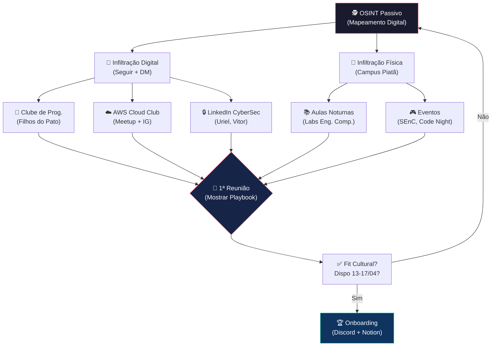

# 🎯 Relatório de Inteligência OSINT: SENAI CIMATEC (Piatã, Salvador-BA)
**Data do Relatório:** 12/03/2026
**Área de Operação:** Recrutamento de 2 Alunos de Nível Superior para Escuderia GP SENAI 2026
**Temática:** Cibersegurança e Ética Digital

---

## 1. 📍 Dados do Alvo (Campus Físico)

| Campo | Detalhe |
|:---|:---|
| **Nome Oficial** | Universidade SENAI CIMATEC |
| **Endereço** | Av. Orlando Gomes, 1845 - Piatã, Salvador - BA, 41650-010 |
| **Telefone** | (71) 3879-5501 |
| **Site Acadêmico** | [senaicimatec.com.br/academico](https://www.senaicimatec.com.br/academico/) |
| **Instagram Institucional** | [@cimatecoficial](https://www.instagram.com/cimatecoficial/) |
| **Instagram Universidade** | [@universidadecimatec](https://www.instagram.com/universidadecimatec/) |
| **LinkedIn (Alumni)** | [23.410+ ex-alunos](https://br.linkedin.com/school/senaicimatec/people) |
| **Calendário Acadêmico 2026** | [PDF Oficial](https://www.universidadesenaicimatec.edu.br/wp-content/uploads/2026/01/481814_923_CalendrioAcadmicodeGraduao2026EADatual-2-1.pdf) |

---

## 2. 🏛️ Grupos e Entidades Estudantis Mapeados

### 2.1 Clube de Programação SENAI CIMATEC ⭐ (PRIORIDADE MÁXIMA)
O grupo estudantil mais relevante para nosso recrutamento. Organizam eventos de programação competitiva, a *Semana da Computação (SEMCOMP)* e treinam para a *Maratona SBC*.

| Campo | Detalhe |
|:---|:---|
| **Instagram** | Procurar pelo perfil exato via [Post Gestão 2026](https://www.instagram.com/p/DVBnpEFER9n/) |
| **Gestão 2026** | Chapa **"Filhos do Pato"** ✅ |
| **Processo Seletivo** | **ABERTO!** (Status: março 2026) |
| **Eventos Recorrentes** | **Code Night** (maratona interna), **SEMCOMP** (OCC), Treinamento Beecrowd/SBC |
| **Post Chave** | [Gestão 2026 anunciada](https://www.instagram.com/p/DVBnpEFER9n/) |
| **Beecrowd** | Torneios registrados no [Beecrowd](https://judge.beecrowd.com/) |

> **🔥 AÇÃO IMEDIATA:** O processo seletivo do Clube está ABERTO agora. Entrar no Instagram do Clube, seguir, e mandar DM perguntando sobre o processo / se existe grupo no WhatsApp. Infiltrar-se neste grupo é o caminho mais rápido para encontrar devs competitivos dispostos a participar do GP.

---

### 2.2 AWS Cloud Club at SENAI CIMATEC ⭐ (PRIORIDADE ALTA)
Clube recém-fundado (primeira iniciativa oficial da AWS na instituição). Alunos aqui são de nível avançado em Cloud, DevOps e potencialmente CyberSec.

| Campo | Detalhe |
|:---|:---|
| **Meetup** | [meetup.com/aws-cloud-club-at-universidade-senai-cimatec](https://www.meetup.com/aws-cloud-club-at-universidade-senai-cimatec/) |
| **Captain Atual** | **Marcos Paulo** (Cloud Club Captain) |
| **Processo Seletivo** | **ABERTO!** |
| **Post Chave** | [PS Aberto (IG Reel)](https://www.instagram.com/reel/DVYxXmCDnNR/) |

> **🔥 AÇÃO:** Seguir o Meetup e o perfil do AWS Cloud Club. Participar do próximo evento. Membros deste clube têm perfil ideal: cloud-native, security-aware, e provavelmente cursam Eng. da Computação.

---

### 2.3 Atlética Falcons (@atcfalcons)
Hub social e esportivo dos alunos. Organizam eventos massivos (Geek Fest, Falcons Game Day). Menos técnico, mas excelente para *networking* amplo.

| Campo | Detalhe |
|:---|:---|
| **Instagram** | [@atcfalcons](https://www.instagram.com/atcfalcons/) |
| **Eventos** | *Falcons Geek Fest*, *Falcons Game Day* (Sympla) |
| **Sympla** | [Falcons Game Day](https://www.sympla.com.br/evento/falcons-game-day/3182998) |

---

### 2.4 X Semana da Engenharia de Computação (SEnC) ⭐
Evento específico organizado pelo Colegiado de Eng. da Computação. É a *vitrine* dos melhores alunos.

| Campo | Detalhe |
|:---|:---|
| **Instagram Post** | [Anúncio da X SEnC](https://www.instagram.com/p/DVZlzh7CZpO/) |
| **Status** | Verificar datas exatas - parece estar em organização para 2026 |

> **🔥 AÇÃO:** A SEnC é o evento perfeito para abordar alunos de Eng. Comp. presencialmente. Monitore o perfil da universidade para anúncio de datas.

---

### 2.5 Centro de Competência EMBRAPII QuIIN (Quantum Industrial Innovation)
Para recrutar alguém de alto nível em CyberSec, os pesquisadores do QuIIN são o "end game". Eles trabalham com criptografia pós-quântica.

| Campo | Detalhe |
|:---|:---|
| **Site** | [quiin.senaicimatec.com.br](https://quiin.senaicimatec.com.br/) |
| **Eventos** | *Quantum Innovation Week* |
| **Facebook** | [Vídeo CyberSec/QuIIN](https://www.facebook.com/cimatecoficial/videos/1801410360475801/) |
| **Parceiros** | CPQD, EMBRAPII |

---

## 3. 🧑‍💻 Perfis LinkedIn Identificados (Alvos Potenciais)

Estes são perfis públicos encontrados no LinkedIn de alunos de Eng. da Computação do CIMATEC. **Priorize os que mencionam CyberSecurity ou HPC.**

| Nome | Perfil | Destaque |
|:---|:---|:---|
| **Uriel Ribeiro** ⭐ | [LinkedIn](https://br.linkedin.com/in/uriel-ribeiro-6965a4241) | **"CyberSecurity"** no título. Formação técnica em Dev de Sistemas. PERFIL IDEAL. |
| **Vitor Lucena** | [LinkedIn](https://br.linkedin.com/in/vitor-lucena) | 8º semestre Eng. Comp. Estágio em **HPC (Supercomputação)**. Sênior. |
| **Pedro Tanajura** | [LinkedIn](https://br.linkedin.com/in/pedrotanajura) | Estagiário Eng. Comp. CIMATEC. |
| **Felipe Farias** | [LinkedIn](https://br.linkedin.com/in/felipe-farias-929356240) | Dev C#, Eng. Comp. CIMATEC. |
| **Pablo Leal Barreto F.** | [LinkedIn](https://br.linkedin.com/in/pablo-leal-barreto-filho-93319337a) | Suporte técnico, QA/Bugs, Eng. Comp. |
| **Pedro H. Oliveira Campos** | [LinkedIn](https://br.linkedin.com/in/pedro-henrique-de-oliveira-campos-368039277) | Eng. Comp. + Empresário (perfil empreendedor). |

> **🔥 PRIORIDADE 1: Uriel Ribeiro** - Único que declara interesse direto em CyberSecurity. Enviar Cold DM no LinkedIn ASAP usando o script do Playbook.

> **🔥 PRIORIDADE 2: Vitor Lucena** - 8º semestre (veterano), estágio em HPC = infraestrutura pesada. Ideal para Tech Lead.

---

## 4. 📅 Plano de Infiltração Física no Campus (Agenda Tática)

### Dados do Calendário Acadêmico 2026
O PDF do calendário oficial está em: [Link Direto](https://www.universidadesenaicimatec.edu.br/wp-content/uploads/2026/01/481814_923_CalendrioAcadmicodeGraduao2026EADatual-2-1.pdf)

### Janela de Oportunidade
**Hoje é 12/03/2026.** As inscrições do GP fecham em **04/04/2026**. Você tem ~23 dias.

| Dia Sugerido | Horário | Objetivo | Local no Campus |
|:---|:---|:---|:---|
| **Seg-Qui (qualquer)** | 18h30 - 21h30 | Abordar alunos da **graduação noturna** Eng. Comp. | Prédio principal, labs de informática |
| **Evento AWS Cloud Club** | Conforme Meetup | Networking com membros técnicos avançados | Auditórios / Salas de eventos |
| **PS Clube de Programação** | Conforme Instagram | Entrar no PS ou abordar candidatos | Labs de informática / Coworking |
| **Sexta-feira (tarde)** | 16h - 19h | Movimento leve, mais fácil abordar | Praça alimentação / Cantina |

### Checklist Pré-Visita
- [ ] Vestir **farda do SENAI** (passaporte de pertencimento).
- [ ] Levar **notebook** com Playbook + Estratégias abertas (mostrar profissionalismo).
- [ ] Ter o **QR Code** do seu LinkedIn ou Instagram pronto para compartilhar.
- [ ] Preparar **"elevator pitch" de 30s**: *"Sou do técnico, montei um plano tático completo pro GP 2026 focando em CyberSec. Já decupei o regulamento inteiro. Preciso de 2 mentes brilhantes do Superior pra levar esse prêmio. Tem 2 minutos?"*

---

## 5. 🔗 Mapa Completo de URLs e Touchpoints Digitais

### Contatos Diretos (Ação Imediata)
| Canal | URL / Handle | Ação |
|:---|:---|:---|
| LinkedIn (Uriel) | [Perfil](https://br.linkedin.com/in/uriel-ribeiro-6965a4241) | Cold DM com script personalizado |
| LinkedIn (Vitor) | [Perfil](https://br.linkedin.com/in/vitor-lucena) | Cold DM com script personalizado |
| AWS Cloud Club | [Meetup](https://www.meetup.com/aws-cloud-club-at-universidade-senai-cimatec/) | Seguir + inscrever próximo evento |
| Clube de Prog. IG | [Post Gestão 2026](https://www.instagram.com/p/DVBnpEFER9n/) | Seguir, DM pedindo link do WhatsApp |
| Atlética Falcons | [@atcfalcons](https://www.instagram.com/atcfalcons/) | Seguir para eventos sociais |

### Monitoramento Passivo (Ficar de Olho)
| Canal | URL | O que monitorar |
|:---|:---|:---|
| IG Universidade | [@universidadecimatec](https://www.instagram.com/universidadecimatec/) | X SEnC, eventos de CyberSec |
| IG CIMATEC Oficial | [@cimatecoficial](https://www.instagram.com/cimatecoficial/) | Eventos do QuIIN |
| LinkedIn CIMATEC | [Alumni](https://br.linkedin.com/school/senaicimatec/people) | Posts de alunos sobre hackathons |
| QuIIN | [Site](https://quiin.senaicimatec.com.br/) | Palestras cibersegurança quântica |
| Pós-Técnico CyberSec | [Curso](https://postecnico.senaibahia.com.br/curso/especializacao-tecnica-em-ciberseguranca/) | Alunos pós-técnico para base |

### Inscrição GP (Não Esquecer!)
| Canal | URL |
|:---|:---|
| Portal da Indústria | [Notícia Oficial](https://noticias.portaldaindustria.com.br/noticias/educacao/quer-criar-solucoes-para-a-industria-senai-abre-inscricoes-para-o-grand-prix-de-inovacao-2026/) |
| Instagram GP | [Post Oficial](https://www.instagram.com/p/DVwGdiUEQ-E/) |
| Facebook GP | [Post SENAI Nacional](https://www.facebook.com/senainacional/posts/o-grand-prix-senai-de-inova%C3%A7%C3%A3o-est%C3%A1-de-volta-durante-uma-semana-estudantes-de-to/1401355605359730/) |

---

## 6. 🧠 Diagrama: Pipeline de Recrutamento

